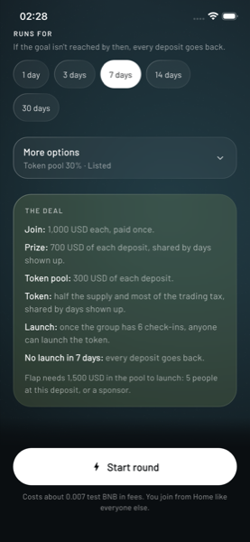

# Cypher Run

**Cypher Run turns showing up into a community, and a community into a launch.**

A group puts in equal deposits and checks in each day they move. Everyone's check-ins fill one bar.
If the group falls short, everyone gets 100% back. If the bar fills, the group launches its own coin
on [Flap](https://flap.sh) Pool Launch, and the piggy bank is split by days shown up.

*Explained like you're 10:* friends put money in a locked jar and walk every day. Each walk is a
sticker on one shared chart. Fill the chart and the group gets its own coin, plus the jar, split by
stickers. Miss the goal and everyone gets their money back.

It runs on BNB Smart Chain testnet (BSC testnet) with test money: test BNB and Flap's free-mint test
USD. Nothing here has real value.

## The pot is safe, the launch is the bonus

| Layer | What it is | What can go wrong |
|---|---|---|
| **The pot** (the core) | The deposits, held by the round's own contract in test USD (it stands in for a stablecoin). Split by days shown up. Group falls short: 100% back. | Only one thing: not showing up. |
| **The launch** (the bonus) | A full bar unlocks a Flap Pool Launch: a new coin, a shop locked forever, half the coins and 80% of 30 days of trading tax to the group. | Only the coin's price. In a sponsored round it can never eat a deposit. |

**Your deposit never touches the coin** in a sponsored round: the sponsor fills the coin's shop (its
trading pool), and the round sends 0% of the deposits there (`liquidityBps` = 0), so every deposit
is prize. In a club round without a sponsor, a set share of each deposit, 30% by default, builds the
shop instead. That round says so before you pay.

**Two endings, always.** The group misses: everyone gets 100% back. The group launches: you're paid
by your days, not by your deposit.

## Try it

**Web app: https://dokind.github.io/kickoff-bnb-hack/** Nothing to install: a wallet is made in the
browser, "Get test dollars" mints the deposit, and the server's faucet sends test BNB for network
fees.

**Judges: join "Bangkok Demo Run"**, the round opened for you:
https://dokind.github.io/kickoff-bnb-hack/#/r/0xcf7957dc48e5c16732331d27e2c2a1b2a9fa5876
(Launcher [`0xcF7957Dc48E5c16732331d27E2C2a1b2A9FA5876`](https://testnet.bscscan.com/address/0xcF7957Dc48E5c16732331d27E2C2a1b2A9FA5876)).
Deposit 100 test USD, goal 12 check-ins, deadline 30 November 2026 00:34 UTC. It is a default round:
30 of each 100 goes to the shop and 70 is prize. Its shop money already comes to 1,530 test USD
(`poolQuoteNow()`, mostly our sponsor money), above Flap's 1,500 floor, so only check-ins decide
the launch. The Keep-Up Guarantee below is for sponsored Season squads, not for this round.

Or install the app, which reads today's steps from Apple Health or Health Connect:

- **iPhone:** TestFlight, https://testflight.apple.com/join/bp4WaEu5 (build 202611261356,
  submitted to Apple's beta review on 26 November 2026; the link opens only after Apple approves
  the beta, and until then it says the beta is not accepting testers).
- **Android 8.0 and later:**
  [cypher-run.apk](https://github.com/dokind/kickoff-bnb-hack/releases/download/android-latest/cypher-run.apk),
  built by GitHub Actions from `main` ([workflow](.github/workflows/android.yml)). Open it on the
  phone and allow installing from the browser. It is signed with a throwaway debug key, so a newer
  build may ask you to remove the old one first.

**Whitepaper:** [docs/WHITEPAPER.md](docs/WHITEPAPER.md) · **Proof on testnet:** [PROOF.md](PROOF.md)
· **Demo steps:** [DEMO.md](DEMO.md)

## Why Flap Pool Launch

**One new rule for Pool Launch: no community, no coin.** Pool Launch lets a Launcher decide what
unlocks a launch. Flap's own example Launcher opens on money raised. We forked it, set the raise
target to 0, and open on days shown up.

1. **For members:** a free bonus on top of a safe pot: coins and a 30-day tax stream, paid for by
   the sponsor, not by them.
2. **For sponsors:** a race or brand doesn't just pay a prize. It launches its community's coin,
   with a crowd that has already proven it shows up, and a shop nobody can drain (the LP is burned:
   nobody can pull its money out, and trading still works).
3. **For Flap:** on any launchpad, most new coins fade because there's no real community behind
   them. Ours can't launch until a community exists: N days of people showing up is the launch
   condition. That's a quality filter no money target can give.

**Community first, coin second.** On most launches the coin comes first and the community, if it
ever comes, comes after, and the earliest buyers get the best price. Flap's classic launch climbs a price ladder (a
bonding curve: the price rises with each buy), which is a fair way to price a coin that has no group
yet. Pool Launch skips the ladder: one transaction makes the coin, fills a PancakeSwap shop and
burns the LP. That is what lets a group that already exists launch together. Here the community
comes first. You can't buy into the group's coins; you earn them by showing up. And for 30 days,
every buy and sell pays the people who showed up: 80% of the 3% buy tax and 5% sell tax goes to the
group's piggy bank.

**A fair launch.** No presale, no team or creator coins, no sponsor coins. 50% of the coins go to
the group, split by days; 50% sit in the locked shop. Nobody else gets coins, us included.

## Who it is for: with a sponsor or without

| Path | Who fills the shop | When it can launch | What a member gets |
|---|---|---|---|
| **A. Sponsored Season** (the flagship), squads of 10 | A race, brand, employer or charity walk: at least Flap's floor, 1,500 test USD per squad at our factory's 1x | The squad's bar fills (goal 240) | Every deposit is prize, split by days; the Keep-Up Guarantee; coins and tax on top |
| **B. Club round, no sponsor** | The club itself: a share of each deposit (`liquidityBps`, 30% by default) | The bar fills **and** deposits × 30% reach 1,500: 5,000 test USD of deposits (50 × 100, or 20 × 250) | 70% of the deposits are prize. At the average: at least 70% back in test USD, plus coins and tax. No guarantee badge |
| **C. Small clubs, pooled** | Five 10-person clubs × 100 test USD = 5,000; 30% = 1,500, Flap's floor, with no sponsor at all | One round, one bar, many clubs | As in B |
| **D. A small club alone** (our ask to Flap) | A lower floor multiplier for our factory, Flap's admin setting (ours reads 1x = the full 1,500) | At 0.1x the floor is 150: 10 people × 50 test USD × 30% = 150 | As in B |

- **A, sponsored Seasons.** A Season is one event with one set of dates, made of squads of 10, and
  each squad is its own round: one bar, one piggy bank, one coin. Why squads: the goal is fixed
  when a round is created, so the head count must be known. Ten makes the goal fillable
  (10 × 30 days × 0.8 = 240) and the scarcity real: the app stops offering Join at 10 and a new
  squad opens when one fills (a join sent straight to the contract still works). The sponsor's
  money is only spent if the squad shows up; if it doesn't launch, the sponsor gets it all back.
  Sponsors buy people showing up under their name, counted on chain.
- **B, a club round without a sponsor.** The honest trade-off: that share of each deposit becomes
  locked shop money at launch.
- **C, small clubs.** A lone club of 10 at 100 test USD each can't reach Flap's 1,500 floor without
  a sponsor (it would need 500 each at 30%, or a lower floor multiplier); pooled into one bigger club round it can, today, with no sponsor and no change from Flap. Club tags and
  leaderboards inside one round are v2.
- **D, the ask.** "Set our factory's floor multiplier to 0.1x on testnet: the floor drops to 150, so
  a club of 10 launches with no sponsor. Days shown up are the filter." The multiplier is a setting
  on Flap's side, not ours (`setLauncherFactoryMultiplier`, per factory; ours reads 1x). Why Flap
  might agree: every one of our launches already has a community behind it, because days shown up
  open the launch, not money.

**The honest catch for every path: no launch, no stake.** If a round hasn't launched by its
deadline, every member gets 100% back, including members with 0 days. The split by days only
happens through the launch. That is why the floor matters so much for small clubs, and why our ask
to Flap is real. *v2, "club mode":* if the bar fills but the shop can't reach the floor, split the
pot by days with no coin (a contract change).

## Any club, not just running

It sounds like a running club. It works for any club where showing up can be stamped. Walking and
running come first because phones already count steps. Today the only stamp is steps: Apple Health
or Health Connect in the phone apps, or a number typed on the web (a testnet-only switch). Later
stamps, through more attesters on the BNB Attestation Service: a gym door QR code, Strava or Garmin
runs, GitHub commits for a coding club, Duolingo for a language club, a teacher's sign-off for a
study group. None of these work today.

## Season 1: Show Up 30

Our first sponsored Season, with two named promises: the **Keep-Up Guarantee** and the
**Fall-Short Refund**. The first squad, "Season 1 Squad A", was created and sponsored on BSC testnet
on 26 November 2026, before check-ins start on 1 December 2026:
[Join Squad A · starts Tue 1 Dec](https://dokind.github.io/kickoff-bnb-hack/#/r/0xa60e2f022d891dd394415a594c9e33614c019153) ([PROOF.md](PROOF.md), "Season 1 Squad A"). It is not
featured before judging.

| When (UTC; a new day starts at 07:00 in Bangkok) | What happens |
|---|---|
| Now (pre-season) | Join now. Everyone starts at 0 days. |
| Tue 1 Dec to Wed 30 Dec 2026 | Check-ins: 30 days, one per wallet per UTC day. |
| End of Mon 7 Dec | The app stops taking joins: the last day a newcomer can still reach 24 of 30. |
| Thu 24 Dec at the earliest | The bar (240) can fill if all 10 check in every day; from then anyone may press Launch. |
| Thu 31 Dec, 23:59:59 (`1798761599`) | The deadline. If the bar is full and nobody has launched by 31 Dec 12:00 UTC, we press Launch. |
| From Fri 1 Jan 2027 | Refunds, if it did not launch. Season 2 opens. |

The launch is not a fixed date: earliest 24 Dec, latest 31 Dec. Each squad: deposit 100 test USD,
0% of the deposits to the shop, 10 members, goal 240. On testnet we are the sponsor: we fill each
squad's shop with 1,500 test USD, and no fee is charged.

**The Keep-Up Guarantee.** Keep up with the average member: your whole deposit back, or more. Group
falls short: 100% back. *Like you're 10:* if nobody showed up more than you, you can't get back less
than you put in.

- **When it holds** (all of these): the round sends 0% of the deposits to the shop and has a
  sponsor; everyone paid the same deposit; the round launches; and "the average" is all check-ins
  divided by all members, both frozen at launch (members with 0 days and late joiners count).
- **What it covers:** test USD only. Coins and tax come on top and are never promised.
- **Why it's true:** the prize is every deposit, and your share is your days over all days, so days
  at or above the average mean a share at or above your deposit. The proof, with the contract
  lines, is in [the whitepaper](docs/WHITEPAPER.md), section 6.
- **Checked on the real contracts, in every test run:**
  [`contracts/test/KeepUpGuarantee.t.sol`](contracts/test/KeepUpGuarantee.t.sol) plays 1,024 random
  whole rounds for each of 3 properties (1 to 20 members, 0 to 30 days, late joiners, 0-day members,
  tax and claims in between), and pins the numbers we say: a squad at 125 / 83.33 / 0 test USD,
  round 1 at 0% to the shop 1,000 / 500 / 0, and the 96.99 edge below. Run it with
  `cd contracts && forge test --match-contract KeepUpGuarantee`. A one-off deep run of 10,000 rounds
  per property found no failure either.
- **Check in early in your UTC day.** If someone presses Launch before your check-in that day, that
  day doesn't count, and you can end a little under the average (at worst about 96 to 97% of your
  deposit if it happens late in the Season).
- **Not on default rounds.** With 30% of the deposits in the shop, keeping up with the average gives
  at least 70% back in test USD, plus coins and tax. No guarantee badge there.

**Same start day for everyone.** The contract has no start date. Our server signs no Season 1
check-in before 1 Dec or after 30 Dec: a server rule, like the 1,000-step minimum. Late joiners are
paid by their days, like everyone else.

Season 1 is the upcoming flagship, not the stage demo: it refuses check-ins until 1 Dec, so "Bangkok
Demo Run" stays the featured round, and Season 1 is featured only after judging.

## The 100% refund, exactly

- **When:** strictly after the deadline, and only if the coin never launched: the bar was not
  full, or the shop was below Flap's floor, or nobody pressed Launch.
- **How:** each wallet presses Refund itself, once, with no time limit, and pays a tiny test-BNB
  network fee. It is not automatic.
- **How much:** exactly what that wallet paid: the whole deposit, and a sponsor everything it
  sponsored. The same with 0 days or every day.
- **To whom:** only the wallet that paid. No early exit before the deadline; nobody can take anyone
  else's money; we never hold the money. Lose your wallet key and nobody can press Refund for you.
- **If the coin launched:** no refund. The piggy bank is split by days instead.
- **Without our app:** any wallet tool can call it, for example
  `cast send <launcher> "refund()" --legacy --gas-price 1000000000 --gas-limit 150000 --rpc-url https://bsc-testnet-rpc.publicnode.com --interactive`
  (`--interactive` asks for the wallet's key, so it stays out of your shell history).
- **Tested:** 7 contract tests (5 in `CheckInLauncher.t.sol`, 2 against the live Portal on a fork,
  including a full bar that never reached the floor). A real refund on BSC testnet:
  [PROOF.md](PROOF.md), "Refund on testnet".

## Honest limits

Said before you ask:

- **Testnet only, test money. Not audited.**
- **Check-ins are attested by our server, not proven.** Typed steps on the web prove nothing. One
  person can make many wallets (*v2:* proof of personhood).
- **Coins and tax are worth only what trading makes them.** Round 1's tax came from our own test
  trades.
- **Flap's Guardian can upgrade the contracts** (through the beacon). We hold no owner key, and
  there is no withdraw function: we never hold the money.
- **The 1,500 floor is Flap's** and can change.
- **Season 1's start day and join window are server and app rules**, not contract rules (*v2:* on
  chain).
- **Legal:** a commitment device, not a game of chance, but pooled forfeits and a launched coin need
  a lawyer in each market.

## Explained simply

- A round is a **vending machine made of code** (a smart contract) that holds everyone's deposit.
  It has no withdraw function: not for us, the creator or a sponsor.
- Each day you walk 1,000 steps or more, you check in, once a day: **a sticker for today**. Every
  check-in fills **the bar** (everyone's stickers together).
- When the bar is full, anyone presses Launch. That makes **a new coin**: 1,000,000 of them. Half go
  into **the shop** (the coin's trading pool, a liquidity pool) with the shop money; half go into
  **the group's piggy bank** (the vault), with the prize: every deposit in a sponsored round, 70% of
  them in a default round.
- **The shop is locked forever** (the LP tokens are burned): nobody can pull the money out, and
  people can still trade.
- For 30 days every trade pays **the tax**, 3% on buys and 5% on sells: 80% goes to the piggy bank,
  20% is burned.
- The piggy bank is **split by days, not by dollars**: your days over everyone's days. 0 days gets
  nothing.
- Not launched by the deadline (the bar not full, the shop under Flap's floor, or nobody pressed
  Launch): each member presses Refund and gets back exactly what they paid.

The longer version: [docs/pitch/EXPLAINED.md](docs/pitch/EXPLAINED.md).

| Home | Start a round | Wallet | Invite |
|:---:|:---:|:---:|:---:|
|  |  |  |  |

iPhone simulator captures, 26 November 2026, taken before that day's last wording changes. Home
now puts THE PRIZE (what each day shown up is worth) right under the round cards, amounts read
"test USD", and Start round says a launch needs both the check-ins and 1,500 test USD of shop money
(its "Shop money" choice now also offers 0%, "a sponsor fills the shop"). The invite capture was taken before the web app moved to GitHub Pages, so its link still
shows the earlier tunnel address; invite links now read
`https://dokind.github.io/kickoff-bnb-hack/#/r/<launcher>`.

## How it works

1. A round is one contract, our Launcher, created through the Flap Portal. Everyone pays the same deposit in test USD.
2. Each day you move, you check in. Our server checks the report (at least 1,000 steps, a server rule) and signs the day; your own wallet records it on chain. The contract allows one check-in per wallet per UTC day.
3. All check-ins (days shown up) fill one bar. When it is full, at or before the deadline, anyone can launch the round's coin through Flap Pool Launch, once.
4. The launch makes 1,000,000 coins. Half go into a PancakeSwap pool with the pool money (all sponsor money plus `liquidityBps` of the deposits: 30% by default, 0% in a sponsored Season), and the LP tokens are burned, so nobody can withdraw that liquidity. The other half go to the round's vault, with the prize: the rest of the deposits. Flap's Portal needs at least 1,500 test USD of pool money at our factory's 1x setting.
5. For 30 days trades pay a 3% buy and 5% sell tax: 80% goes to the vault, 20% is burned. The vault is shared by days: your days over all check-ins, so 0 days gets nothing. Not launched by the deadline: each member presses Refund and gets back exactly what they paid.

**What is new about the launch.** Flap's crowd example opens the launch when enough money is
raised. Ours opens it on check-ins: only when the members have shown up often enough together,
counted on chain, and then **anyone** can send the launch transaction: no operator, no admin, not
our server. Flap's pool floor still has to be met, but money alone never opens the launch.

## Built on Flap Pool Launch

| What | Address or transaction |
|---|---|
| Our Launcher Factory, `CheckInLauncherFactory` (rounds are created with `Portal.newLauncher`) | [`0x2A872200B83dD025977d785cDE05356d23eA4153`](https://testnet.bscscan.com/address/0x2A872200B83dD025977d785cDE05356d23eA4153) |
| Enabled on Flap's testnet Portal at 1x (`launcherFactoryMultiplier` reads `true, 10000`) | [`0x2a7d7106…d9ad45`](https://testnet.bscscan.com/tx/0x2a7d71063496b439a12248f90b133ce5230d7c9581a25b6af84ede2ec3d9ad45) |
| Our vault factory, `StreakVaultFactory` (the Portal creates each round's vault through it at launch) | [`0x0652AAD1d659344f6EdB9572723479aaece144Be`](https://testnet.bscscan.com/address/0x0652AAD1d659344f6EdB9572723479aaece144Be) |
| Flap Portal (testnet) | [`0x000042108465206185A077Edc3F3fd2b49060000`](https://testnet.bscscan.com/address/0x000042108465206185A077Edc3F3fd2b49060000) |
| First launch, sent by an ordinary member wallet (`launch()` calls `Portal.launchTaxTokenV2`) | [`0xe9d53da5…adb896`](https://testnet.bscscan.com/tx/0xe9d53da5e8ce1bc49e859a42a1f55879a6f056fb3a09b5dca8a9aa55e3adb896) |
| Its coin, "Bangkok Showup" | [`0x79F03A11234CFF1Bca37860B29ddb6a7947B7777`](https://testnet.bscscan.com/address/0x79F03A11234CFF1Bca37860B29ddb6a7947B7777), [on Flap's testnet site](https://abc.flap.sh/bnb-testnet/0x79F03A11234CFF1Bca37860B29ddb6a7947B7777) |
| Its vault, which received the prize, half the supply and 183.48 test USD of trading tax, and paid out all the test USD by days (822.32 and 411.16) | [`0x93873812C48C9f5fCD3594fD651Ce9Ce96c75728`](https://testnet.bscscan.com/address/0x93873812C48C9f5fCD3594fD651Ce9Ce96c75728) |

- **What Flap does.** In the one `launch()` transaction the Portal creates the coin (1,000,000
  supply, a 3% buy and 5% sell tax, a 30-day `taxDuration`), seeds the PancakeSwap pool with the
  pool money and half the supply, burns the LP, creates our vault through `StreakVaultFactory`, hands it the other half
  of the supply, and routes the tax through two fee slots: a vault slot of 80% and a burn slot of 20%.
- **What we wrote.** The launch condition (a check-in counter, not a raise target), the escrow of
  deposits and sponsor money, refunds, and the vault that pays by days. Flap's base contracts in
  `contracts/src/flap/` are used unmodified.
- **Proof.** Every address, transaction and amount of the first complete round, and what was read
  on 26 November 2026, is in [PROOF.md](PROOF.md).
- **Round 1, read as a split, not a gain.** Three member wallets paid 500 test USD each; 450 (30%)
  went to the shop and 1,050 was the prize, and we sponsored 1,050 so the shop reached 1,500. The
  piggy bank got the 1,050 plus 183.48 of tax, all of it from our own 17 test swaps, and split it by
  days: 2 days, 822.32 test USD and 333,333.33 coins; 1 day, 411.16 and 166,666.67; 0 days, nothing.
  The same round sponsored with 0% to the shop would have paid 1,000, 500 and 0 before tax: the
  member at the average gets exactly the deposit back.

## Setup

You need [Foundry](https://getfoundry.sh), Node.js 22 or newer, and Flutter 3.41 or newer. Never put
a real key in a file that is committed: each part has a `.env.example` with placeholder names, and
`.env` is git-ignored. Use throwaway testnet keys only.

```sh
# Contracts
cd contracts
./install-deps.sh        # forge-std, OpenZeppelin and solady at pinned commits into lib/
cp .env.example .env     # BSC_TESTNET_RPC_URL; PRIVATE_KEY only when deploying
forge test               # 75 pass; the fork suite is skipped when BSC_TESTNET_RPC_URL is empty
BSC_TESTNET_RPC_URL=https://bsc-testnet-rpc.publicnode.com forge test   # 80, with 5 fork tests

# Server
cd verifier
npm install
cp .env.example .env     # RPC_URL, ATTESTER_PRIVATE_KEY, ADMIN_TOKEN; see the comments in the file
npm run dev              # http://localhost:8787 (the same routes also under /api)
npm test && npm run typecheck

# App
cd app
flutter pub get
flutter analyze && flutter test
flutter run -d chrome --dart-define=VERIFIER_URL=http://localhost:8787
```

`VERIFIER_URL` fixes the server's address for local work. A build without it finds the server
through OriginRegistry (see "Hosting").

## How a round works

One Launcher contract is one round. It is created through the Flap Portal with our own Launcher
Factory (`Portal.newLauncher` with `CheckInLauncherFactory`).

| Step | What happens | Contract call |
|---|---|---|
| **Join** | A wallet pays the round's fixed deposit once, in test USD, and becomes a member. | `CheckInLauncher.join()` |
| **Sponsor** (optional) | Anyone may add test USD. It goes to the token pool only and earns no share. If the round doesn't launch, it comes back with Refund. | `sponsor(amount)` |
| **Check in** | A member checks in once per UTC day. Each check-in needs our server's signature for that wallet and day, and adds 1 to the member's days and to the bar. | `checkIn(day, signature)` |
| **Launch** | Once the bar is full (`totalCheckIns >= checkInGoal`), at or before the deadline, with pool money above 0, anyone calls it, once. The token pool gets all sponsor money plus `liquidityBps` of the deposits (30% by default, 0% in a sponsored Season) and half the token supply; Flap burns the LP. The rest of the deposits, the prize, and the other half of the supply go to the round's vault. The token has a 3% buy and 5% sell tax (`taxDuration` 30 days); 80% of the tax flows to the vault and 20% is burned. | `launch()` |
| **Claim** | A member with `d` days receives `d / totalCheckIns` of the reserved tokens, once, and the same fraction of the test USD the vault has received (prize plus trading tax), again whenever more tax has arrived. A member with no days gets nothing. There is no settle step and no list. | `StreakVault.claim()` |
| **Refund** | Strictly after the deadline, and only if there was no launch (a bar that never filled, a bar nobody launched, or a pool below Flap's floor), each wallet presses refund: a member takes the full deposit back and a sponsor their contribution. On testnet: [PROOF.md](PROOF.md), "Refund on testnet". | `refund()` |

An example with the numbers the tests use: three members at 1,000 test USD, 30% to the token pool.
The pool would get 900, under the 1,500 test USD floor Flap's Portal enforces today, so a sponsor
adds 600. At launch the pool gets 1,500 and the vault gets the 2,100 prize and 500,000 tokens. With
days 3, 2 and 1 the members receive 3/6, 2/6 and 1/6 of the tokens and of the prize plus tax.

## Enforced on chain, and attested by our server

| Enforced by the contracts | Attested by our server |
|---|---|
| Who is a member, and that everyone paid the same deposit once | **That a wallet moved enough on a given day.** The server signs a daily check-in after it accepts a report of 1,000 to 80,000 steps (a server rule; the contract does not see steps): steps from Apple Health in the iPhone build, or a number typed in on the web (self-reported, a testnet-only switch). |
| One check-in per wallet per UTC day, for today or yesterday only, members only, closed at launch | **Season start and end days.** For a Season squad the server signs no check-in before the first day or after the last (Season 1: 1 to 30 December 2026). The contract has no start date. |
| The count: `daysOf[wallet]`, `totalCheckIns`, the goal, the deadline | |
| Launch only with a full bar, only before the deadline, only once, callable by anyone | |
| The split: sponsor money plus `liquidityBps` of the deposits to the token pool, the rest to the vault | |
| Claims in proportion to days; refunds in full after a deadline with no launch | |
| No withdraw function on the Launcher or the vault: not for the attester, a sponsor, the creator or the deployer | |

The attester is one address, fixed when the round is created: the key of our server.

- **Check-ins are attested, not proven.** The contract cannot see anyone's activity and takes the
  signature as given. The server can sign for a member who did not move, or refuse to sign for one
  who did, and it cannot verify a step count a client sends. Members rely on the operator of that
  server for this, and for nothing else.
- **What the attester cannot do.** It cannot launch early (the bar needs `checkInGoal` check-ins,
  each from a wallet that paid a deposit, at most one per wallet per day). It cannot block or delay
  a launch once the bar is full (`launch()` is open to anyone). It cannot choose who is paid other
  than by signing or not signing daily check-ins. It cannot move funds: it has no function on
  either contract and receives nothing.
- **If it stops signing**, the bar never fills, and after the deadline everyone is refunded.
- Flap's Guardian can upgrade the Launcher and vault implementations, as in Flap's own example. So
  we say "we never hold the money", not "nobody can ever touch it".

## Known limits

Stated plainly, each with what version 2 changes. The full list of edge cases, with the contract
lines, is in [the whitepaper](docs/WHITEPAPER.md), section 12.

- **A member who joins near a full bar can get nothing.** The vault pays by days, and days are
  frozen at launch. If the bar fills and someone launches before a new member's first check-in, that
  member has 0 days: the prize part of their deposit goes to the others and the rest to the token
  pool. When what is left of the goal is no more than one check-in per member (the bar can fill
  today), the join sheet says so and the deposit takes a second press, "Join anyway". *v2:* a join
  cutoff and a minimum round length in the Launcher.
- **The bar can fill before the last day.** Anyone may launch as soon as it is full, and the goal is
  fixed when the round is created. Season squads of 10 with goal 240 can fill on day 24 at the
  earliest. *v2:* an on-chain `launchOpensAt`, and a goal that scales with the head count.
- **Reserved tokens are claimable and liquid right after launch.** `claim()` works from the next
  transaction and the tokens can be sold at once, so the first member to sell gets the best price
  from the pool and later sellers less. Count on the prize, not the coin. *v2:* release them over
  the tax window (the launch's 30-day `taxDuration`) through a vault upgrade.
- **The tax share is fixed at launch.** Each member's share of the trading tax is their days before
  launch over all check-ins before launch. Check-ins close at launch, so showing up afterwards earns
  nothing more, and stopping afterwards costs nothing. *v2:* keep counting check-ins during the tax
  window and share the tax by those days.
- **Check-ins are attested by one server key.** Its exact bound, from
  [`contracts/src/CheckInLauncher.sol`](contracts/src/CheckInLauncher.sol): a signature is good for
  one wallet, one UTC day, one round and one chain; the contract takes it only in a transaction sent
  by that member, only for the current or the previous UTC day, at most once per member per day, and
  only before the launch and the deadline. So the key can give a member at most one day for each UTC
  day from the day before they joined to the launch, and can withhold any day. It has no function on
  the Launcher or the vault: it cannot launch, block a launch, or move or receive funds. *v2:*
  attestations through the BNB Attestation Service, a KMS-held key, and a new attester for new rounds.
- **Typed check-ins on the web are a testnet-only switch.** With `ALLOW_SELF_REPORTED=true` the
  server signs a number someone typed. It is how the web demo works and it proves nothing. *v2 and
  mainnet:* off; check-ins from phone health data only, with checks on the source.
- **The attester can sign a day before the round opened.** The contract accepts yesterday whatever
  the round's age. The server signs today only, but the key itself can sign yesterday: in round 1 the
  script signed a check-in for 24 November in a round opened on 25 November
  ([PROOF.md](PROOF.md)). *v2:* the Launcher records its opening day and refuses earlier days.

## What breaks at 10,000 users

| Part | Today | Fix |
|---|---|---|
| Server store | One JSON file (`DATA_FILE`), rewritten whole on each change | Postgres |
| Round and member discovery | Rounds from a log scan of the factory's creation events, in chunks from its deploy block; members are only the wallets this server has seen | An indexer on the factory and each Launcher's events, with paged lists |
| RPC | One public endpoint for the server, and the first of two public endpoints in the app | A paid endpoint with a fallback |
| Attester key | One key in an env var; it signs check-ins and announces the host (the faucet already pays from its own key, `FAUCET_PRIVATE_KEY`) | A KMS-held key; a new attester for new rounds, which is a per-round setting already |
| Gas faucet | 0.012 test BNB per new wallet at the event (`FAUCET_DRIP_BNB`; the server's default is 0.03) from one faucet wallet, 200 wallets in all | Sponsored gas through a BSC paymaster |
| Hosting | A Cloudflare quick tunnel whose host changes on restart | A named tunnel or a VM; the apps already find the host through OriginRegistry, so moving needs no new build |

## Roadmap (v2: contract changes, after the hackathon)

- **Season rules on chain.** `startTime`, `joinUntil` and `launchOpensAt` in the Launcher (launch
  only after the last check-in day), and a goal as a rate (members × days × a share), so the bar
  scales with whoever joins.
- **Club mode.** When the bar fills but the shop can't reach Flap's floor, split the pot by days
  with no coin.
- **A deposit-back waterfall** in the piggy bank: members with at least k days are repaid first.
- **Club tags and leaderboards inside a Season**, so many small clubs can share one round.
- **More stamps** (a gym door, Strava, GitHub, and more) through the BNB Attestation Service, and
  proof of personhood: one wallet per verified person.
- **Wallets and gas.** Passkey wallets with recovery, and gas sponsored through a BSC paymaster, so a
  new member needs no test BNB.
- **Audit, then Flap mainnet** with a real stablecoin. Mainnet needs Flap's audit and approval of
  the factory there.
- **Rounds that feed rounds.** Round N's tax can seed round N+1's shop through `sponsor()`, which
  anyone can call today: a member claims and sponsors the next round.

## Business model

Members pay a deposit, never a fee. Sponsors pay two things:

1. **The shop money, on chain.** At least Flap's floor, 1,500 test USD per squad today. It is spent
   only if the squad shows up and launches; otherwise the sponsor takes it all back with Refund.
2. **Our flat fee per sponsored Season, off-chain.** None has been charged yet, and nothing in the
   contracts takes a fee.

Clubs without a sponsor pay nothing extra: their shop comes from their own deposits. A sponsored
round sets `liquidityBps` to 0, so 100% of the deposits are prize: the factory accepts any value
from 0 to 10,000 ([`CheckInLauncherFactory.sol`](contracts/src/CheckInLauncherFactory.sol) refuses
only values above 10,000), and `launch()` needs a non-empty pool, so with 0% the sponsor's money is
the pool. What a sponsor buys: people showing up under its name, counted on chain.

A worked example, a Season 1 squad: 10 members at 100 test USD, `liquidityBps` 0, goal 240, a
1,500 test USD sponsor. Six members check in 30 days, three 20 days and one never (240, the bar is
full; the average is 24 days). The prize is all 1,000 test USD of deposits. Each 30-day member gets
125 test USD and 62,500 coins, each 20-day member 83.33 test USD and 41,666.67 coins, and the
0-day member nothing; tax comes on top. That is the deposits split by days, not a return.

*v2:* a treasury slot in a new factory, taken from the tax's burn share: the vault keeps its 80%,
and the 20% that is burned today goes to a treasury instead.

## Parts

```
 web / phone app (Flutter) ──signed daily report──►  server (Node, Hono): the attester
        │                  ◄──attester signature, rounds, streaks, gas faucet──
        │
        │ join, sponsor, checkIn(day, signature), launch, claim, refund
        ▼
  CheckInLauncher ──launch(), anyone──► Flap Portal ──► token + pool + StreakVault
```

| Part | Folder | What it does |
|---|---|---|
| Contracts | [`contracts/`](contracts) | `CheckInLauncherFactory`, `CheckInLauncher`, `StreakVaultFactory`, `StreakVault` (Solidity 0.8.26, Foundry), forked from Flap's Crowd launcher and vault example, and `OriginRegistry`. They hold the deposits, the sponsor money, the reserved tokens and the tax, and apply the rules above. |
| Server | [`verifier/`](verifier) | HTTP server (Hono, viem). Finds every round our factory created from the factory's creation events and serves the list; accepts a member's daily report and signs the check-in for that round; relays what the chain says about each round; keeps streaks and the members it has seen; sends a new wallet a little test BNB once for gas (0.012 at the event, from the faucet's own wallet); writes its own host to OriginRegistry. It sends no transaction to the Launcher or the vault. |
| App | [`app/`](app) | One Flutter app, our own UI. Web build: onboarding with a wallet made in the browser, Home with every listed round as cards and one action that follows the round on screen (join, check in, launch, claim, refund), an invite link and QR code per round, sponsor, start a round, wallet. iPhone build: the same, with steps from Apple Health. |
| Scripts | [`scripts/`](scripts) | `deploy-testnet.sh` deploys the factories and prints the app build commands. `run-round.ts` runs one whole round on testnet, or with `CREATE_ONLY=true` only opens and sponsors a round (a Season squad) and stops. `refund-proof.ts` runs the refund ending on testnet: a full bar, no launch, 100% back after the deadline. `preflight.sh` is the read-only check before a demo. |
| Hosting | [`deploy/`](deploy) | The server's compose file and Caddy config. |

Each part's README has the full reference: [`contracts/README.md`](contracts/README.md),
[`verifier/README.md`](verifier/README.md), [`app/README.md`](app/README.md),
[`scripts/README.md`](scripts/README.md).

## Hosting

- **The web app is on GitHub Pages** at https://dokind.github.io/kickoff-bnb-hack/ (base path
  `/kickoff-bnb-hack/`, hash routes). A round's invite link is
  `https://dokind.github.io/kickoff-bnb-hack/#/r/<launcher>`.
- **The server stays where it is**, reached through a Cloudflare quick tunnel whose host changes
  when the tunnel restarts.
- **The server announces its host on chain.** [`OriginRegistry`](contracts/src/OriginRegistry.sol)
  at [`0xb9aD45Dc177C801f10670F2aac03B467f1C367d2`](https://testnet.bscscan.com/address/0xb9aD45Dc177C801f10670F2aac03B467f1C367d2)
  holds one string, `origin()`, which only the attester key can set. With `ORIGIN_REGISTRY` set, the
  server finds its public host (`ORIGIN_HOST`, or the tunnel's own report) every 60 seconds and sends
  `setOrigin(host)` when the two differ.
- **The apps read it.** Before their first call they read `origin()` and call
  `https://<host>/api`, and they look again when a call cannot reach the server. No build has the
  tunnel host baked in.
- The registry holds no funds and gates nothing: a wrong value can only send the apps to a server
  that cannot sign check-ins for any round.

The server needs `ALLOW_SELF_REPORTED=true` for check-ins typed in a browser and
`FAUCET_ENABLED=true` for the gas faucet.

## Deployed on BSC testnet

Deployed 25 November 2026 from `0xc1bD6aC9311b9345ae8023201875518429c8BF58`; the record is
[`contracts/deployments/bsc-testnet.json`](contracts/deployments/bsc-testnet.json).

| Contract | Address | Deployment transaction |
|---|---|---|
| `CheckInLauncherFactory` (our Launcher Factory) | [`0x2A872200B83dD025977d785cDE05356d23eA4153`](https://testnet.bscscan.com/address/0x2A872200B83dD025977d785cDE05356d23eA4153) | [`0x827f9b4e404217a35e75fbef0f9ea0012f1c3e0d490ac87a88e31c44079c094c`](https://testnet.bscscan.com/tx/0x827f9b4e404217a35e75fbef0f9ea0012f1c3e0d490ac87a88e31c44079c094c) |
| `StreakVaultFactory` | [`0x0652AAD1d659344f6EdB9572723479aaece144Be`](https://testnet.bscscan.com/address/0x0652AAD1d659344f6EdB9572723479aaece144Be) | [`0x19a6d3aa23f2d6e5458965070462f1411a62256d67403f8127232b4fa1deb2a6`](https://testnet.bscscan.com/tx/0x19a6d3aa23f2d6e5458965070462f1411a62256d67403f8127232b4fa1deb2a6) |
| `OriginRegistry` (26 November 2026) | [`0xb9aD45Dc177C801f10670F2aac03B467f1C367d2`](https://testnet.bscscan.com/address/0xb9aD45Dc177C801f10670F2aac03B467f1C367d2) | [`0x0387d2b0e7a84d0a6b72f26d2fdd8ebc4fadd0bfb7620aa7cd231f4498596098`](https://testnet.bscscan.com/tx/0x0387d2b0e7a84d0a6b72f26d2fdd8ebc4fadd0bfb7620aa7cd231f4498596098) |

The Launcher Factory is enabled on Flap's testnet Portal at the standard 1x multiplier:
`launcherFactoryMultiplier(0x2A87…4153)` reads `true, 10000`. It was enabled on 26 November 2026
through Flap's testnet helper `0x77779969a11eff7582f3bCf48135A846A3457777` in
[`0x2a7d71063496b439a12248f90b133ce5230d7c9581a25b6af84ede2ec3d9ad45`](https://testnet.bscscan.com/tx/0x2a7d71063496b439a12248f90b133ce5230d7c9581a25b6af84ede2ec3d9ad45).
Anyone can call that helper for any factory, so read the value back before a demo
([DEMO.md](DEMO.md) has the command). Mainnet would need Flap's audit and approval.

| Fixed address | |
|---|---|
| Attester (our server's key; the only address OriginRegistry accepts) | `0x2F2ab3dA0b824F9cA3EdD2580443Ca0b271EfDD7` |
| Faucet wallet (its own key, `FAUCET_PRIVATE_KEY`; pays `FAUCET_DRIP_BNB`, 0.012 test BNB, once per new wallet) | `0xaC33dE0fe7C7a2e779A9Ba9C116C1fFe0aCd19f8` |
| Flap Portal | `0x000042108465206185A077Edc3F3fd2b49060000` |
| Test USD (quote token, 18 decimals, anyone can mint) | `0x190C989D5665a0e404B444b53CAE9AbCfb600157` |

Seven rounds have been opened with these factories on testnet (the factory's
`CheckInLauncherCreated` events, read on 26 November 2026 at 10:40 UTC for the first five and at
13:30 UTC for all seven):

| Round | Launcher | Created by | State on 26 Nov 2026, 10:40 UTC |
|---|---|---|---|
| "Bangkok Showup" | `0xe1c165C295ED8bC0abA2a81c2a524564689BCeAB` | `scripts/run-round.ts` (the deployer wallet) | launched, 3 of 3, every claim paid |
| "Demo Day" | `0x378d729aE7122e5Cf7d6f4ed8797710d2503EDb5` | `scripts/run-round.ts` (the deployer wallet) | open, 4 of 5, 6 members (two with 0 days) |
| "morning movers" | `0x74B9218cC901fa4b295C3B021c246E6f1022915B` | the app's "Start a new round", wallet `0x580d21E31B49D8D21AD1d4E79F676142577e2997` | open, 1 of 6, 2 members |
| "Night Owls" | `0x45ae23e5e28b4c90ce10f43266a7aa52d05ec608` | the app's "Start round", wallet `0x95Ced7B6D811509F8741c1C5B352353f3Ff8F4C2` | open, 1 of 6, 1 member, unlisted |
| "Bangkok Demo Run", the judges' round | [`0xcF7957Dc48E5c16732331d27E2C2a1b2A9FA5876`](https://testnet.bscscan.com/address/0xcF7957Dc48E5c16732331d27E2C2a1b2A9FA5876) | `scripts/run-round.ts` (the deployer wallet) | open, 3 of 12, 4 members, token pool 1,530 test USD, deadline 30 Nov 2026 00:34 UTC, the server's featured round |
| "Refund Proof" | [`0xCDA4Fd2CD2Ca192216C64A827a0627e9d5BD092d`](https://testnet.bscscan.com/address/0xCDA4Fd2CD2Ca192216C64A827a0627e9d5BD092d) | `scripts/refund-proof.ts` (the deployer wallet, also its attester) | opened 26 Nov 13:12 UTC; bar 1 of 1 but never launched (its shop was under Flap's floor); refunded after its deadline at 13:22 UTC, holds 0 test USD; unlisted: its attester is the deployer, so the server's public list leaves it out |
| "Season 1 Squad A" | [`0xA60e2f022D891Dd394415A594c9e33614c019153`](https://testnet.bscscan.com/address/0xA60e2f022D891Dd394415A594c9e33614c019153) | `scripts/run-round.ts`, create-only (the deployer wallet; attester: our server) | opened 26 Nov 13:13 UTC; open, 0 of 240, 0 members, token pool 1,500 test USD (sponsored), 0% of deposits to the shop, deadline 31 Dec 2026 23:59:59 UTC; not featured; check-ins from 1 Dec |

Every address and transaction of the first two, the creation of "Night Owls", the whole refund
proof and the creation of Season 1 Squad A are in [PROOF.md](PROOF.md). "Bangkok Demo Run" is described in [DEMO.md](DEMO.md) and in
[the whitepaper](docs/WHITEPAPER.md).

## Many rounds, round links and unlisted rounds

- **Every round is found on chain.** The server reads the factory's creation events from the block
  the factory was deployed in (144816444), keeps what it found in its store and looks again every
  10 seconds. Nobody has to tell it about a new round.
- **Home shows the listed rounds as cards.** The server's featured round comes first, then rounds
  this wallet has joined, then open rounds by nearest deadline, launched ones and ended ones. The
  streak, the action button, the prize and the members under the cards belong to the card on screen.
- **A round has a link**: `https://dokind.github.io/kickoff-bnb-hack/#/r/<launcher>`. Opening it
  selects that round. The "Invite" sheet shows the link, a copy button and a QR code.
- **A round can be unlisted.** Starting a round has an "Unlisted" switch; the creator's wallet
  signs the choice and the server keeps it. Unlisted means exactly this: the round is not shown in
  the app's public list. Anyone with the link can still open and join it, and anyone reading the
  chain can find it. It is not hidden data.
- **When a new round appears in the list.** At once when its creator's app registers it as listed;
  never when it is registered as unlisted; otherwise three minutes after its creation, so a round
  whose creator is about to register it as unlisted is not shown in between.
- **The featured round** is the one set with `CURRENT_LAUNCHER` or `POST /admin/round`. The earlier
  single-round routes (`/round`, `/me/:address`, `/members`, `/checkin`) still answer for it, so
  app builds from before this change keep working.

## What the three parts agree on

Checked by tests on each side and by the fork run described under "Status".

- **Round config.** `Portal.newLauncher(factory, abi.encode(config))`, where `config` is one tuple
  `(string name, string symbol, string meta, bytes32 salt, uint256 deposit, uint256 liquidityBps, uint256 checkInGoal, uint256 deadline, address attester)`.
  The same 480-byte vector is pinned in `contracts/test/CheckInLauncher.t.sol` and
  `app/test/services_test.dart` and equals `cast abi-encode` of the tuple. The salt is mined from a
  random start so the token address ends in `0x7777`.
- **Check-in signature.** `inner = keccak256(abi.encode(uint256 chainId, address launcher, address wallet, uint256 day))`
  with `day = unix time / 86400`; the attester signs `inner` with personal_sign (EIP-191), 65 bytes.
  One worked vector is pinned in the contracts' test, reproduced byte for byte by
  `verifier/test/attest.test.ts`, and the app's `checkIn(day, signature)` calldata for it equals
  `cast calldata`.
- **Texts a member signs** (personal_sign): `Cypher Run checkin <launcher> <YYYY-MM-DD> <steps>`,
  `Cypher Run faucet <address>` and, by a round's creator only,
  `Cypher Run round <launcher> <listed|unlisted>`. The app writes addresses in lower case; the server
  accepts lower case or checksummed. The round text carries no date: someone who has seen a
  creator's signature could send it again, which only sets that same choice again. The product name
  is one constant in the server and one in the app (`verifier/src/product.ts`, `app/lib/config.dart`);
  renaming it changes the signed texts on both sides. `contracts/src/Product.sol` still says
  "Showup", the working name: it is only used in the description the deployed contracts report, and
  they were not redeployed.
- **API.** `GET /rounds` (the listed rounds), `POST /rounds` (the creator lists or unlists a round),
  and per round `GET /rounds/:launcher`, `GET /rounds/:launcher/me/:address`,
  `GET /rounds/:launcher/members`, `POST /rounds/:launcher/checkin`. For the featured round the
  earlier `GET /round`, `GET /me/:address`, `GET /members`, `POST /checkin` answer the same.
  `GET /round`, `GET /rounds` and `GET /rounds/:launcher` carry `season`: `null`, or the Season 1
  dates for a Season squad (its name, first and last check-in day, last day to join, squad size and
  today's day number). Also `GET /stats`, `GET /health`, `POST /faucet`, `GET /faucet` (for the
  operator: how many more wallets the faucet can fund) and `POST /admin/round`. Every route is also
  under `/api`. Amounts are decimal strings in whole tokens. The apps call `https://<host>/api`,
  with the host read from OriginRegistry.
- **Days are UTC** everywhere. The server signs for today only; the contract also accepts yesterday.
- **Transactions** are legacy type at 1 gwei with explicit gas limits, from the app, the server and
  the scripts. Fee estimation on this testnet answers 1 wei and such transactions are never mined.
  `launch()` uses about 5,000,000 gas; the limit is 7,000,000.
- **Flap's pool floor.** The Portal refuses a launch whose token pool is under 1,500 test USD today,
  at our factory's 1x multiplier (`launcherFactoryMultiplier` 10,000 bps; a Flap admin setting per
  factory, where lower means a smaller minimum). It is a Portal rule measured on testnet, and Flap
  can change it. `poolQuoteNow()` shows what the pool would get; below the floor `launch()`
  reverts and nothing changes, so a sponsor can top up and anyone can call it again.

## Deploy

The factories and the registry are already deployed (addresses above). To deploy the factories again:

```sh
scripts/deploy-testnet.sh --dry-run   # simulates the deploy; sends nothing, writes nothing
scripts/deploy-testnet.sh             # asks, then deploys the two factories (about 0.014 test BNB)
scripts/deploy-testnet.sh --print     # prints the app commands for the last deploy again
```

It runs `forge script script/Deploy.s.sol --rpc-url bsc_testnet --broadcast --slow --legacy
--with-gas-price 1000000000` from `contracts/`, checks that both factories have code, and prints the
app build commands. The web build for GitHub Pages:

```sh
cd app
flutter build web --release --base-href /kickoff-bnb-hack/ \
  --dart-define=CHECKIN_LAUNCHER_FACTORY=0x2A872200B83dD025977d785cDE05356d23eA4153 \
  --dart-define=STREAK_VAULT_FACTORY=0x0652AAD1d659344f6EdB9572723479aaece144Be \
  --dart-define=ATTESTER_ADDRESS=0x2F2ab3dA0b824F9cA3EdD2580443Ca0b271EfDD7
```

`ATTESTER_ADDRESS` must be the address of the server's key (`ATTESTER_PRIVATE_KEY`, or the earlier
name `VERIFIER_PRIVATE_KEY`, in `verifier/.env`). A round created with another attester cannot get
check-ins signed by this server, and this server leaves it out of the public list.

## Demo

The six steps in the app, the checklist before going on stage, and the Season 1 runbook are in
[DEMO.md](DEMO.md).

**A whole round by script.** With the server running (hosted or `npm run dev`) and
`ALLOW_SELF_REPORTED=true`:

```sh
cd verifier && VERIFIER_URL=https://<host>/api npx tsx ../scripts/run-round.ts
```

It opens a round with the deployer key, points the server at it, funds three throwaway members who
join with 1,000 test USD each, sponsors the 600 the pool is short of, checks two of them in through
the server (source "self"), launches from a member wallet, trades on the pool so tax reaches the
vault, and claims. The member who never checked in is shown to get nothing. Settings and the
two-day variant (`CHECKIN_GOAL=3`, a 2 : 1 : 0 split) are at the top of
[`scripts/run-round.ts`](scripts/run-round.ts). The step counts it reports are made up by the
script and sent as self-reported; everything on chain is real. It also makes the new round the
server's featured round, so never run it against the hosted server before judging is over; a
Season squad is created with its create-only mode (see [DEMO.md](DEMO.md)).

Things to know before a demo: days are UTC, so a new day starts at 07:00 in Bangkok and one wallet
can check in once per day; the token pool must reach 1,500 test USD (five members at 1,000, or
fewer plus a sponsor); the iPhone build counts steps since 00:00 UTC against the server's
`MIN_STEPS` (1,000).

## Status

Checked on 25 November 2026; the many-rounds lines and the phone build line on 26 November 2026;
the hosting lines and the chain reads in [PROOF.md](PROOF.md) on 26 November 2026 (Bangkok); the
rounds table, OriginRegistry, GitHub Pages and the Android release on 26 November 2026 at 10:40
UTC; the refund proof, Season 1 Squad A and the server's Season rule on 26 November 2026 between
13:12 and 13:30 UTC; the test counts on 26 November 2026 between 13:20 and 13:30 UTC (20:20 to
20:30 in Bangkok).

Done and checked:

- **Contracts.** 75 tests pass offline (6 of them the Keep-Up Guarantee,
  `test/KeepUpGuarantee.t.sol`; 6 for OriginRegistry) and 80 with a BSC testnet RPC (5 of them whole
  rounds against the live Portal on a local fork; the fork sends nothing). The two factories and
  the registry are deployed on BSC testnet; the Launcher factory reads back its paired vault
  factory, the Portal and the test USD token, and the registry's `announcer()` is the attester.
- **Server.** 203 tests in 11 files pass (`npx vitest run`) and the strict typecheck is clean.
- **App.** `flutter analyze` is clean and 449 tests pass, with one more (the fork test) skipped
  unless it is given a fork.
- **Many rounds, on the hosted server.** The factory's creation events named three rounds and
  `/api/rounds` listed the same three, including "morning movers", which was started from the app.
  Every field the server reported for each equalled a direct chain read. The app's own client read
  the routes from the real server code, and the signature the app makes for
  `Cypher Run round <launcher> <listed|unlisted>` recovers to the signer under the server's text.
- **All three together, on a local fork of BSC testnet taken after the deploy** (the deployed
  factories themselves, the real server code with its real key, no mocks; nothing sent to the real
  testnet):
  - `scripts/run-round.ts` ran a whole round: open through the Portal, three joins, a 600 sponsor,
    two check-ins signed by the server and accepted by the contract, `launch()` refused while the
    bar was short and then sent by a member (4.64M gas), a claim straight after launch, trading,
    37.17 test USD of tax to the vault, and final claims of 1,068.59 test USD and 250,000 tokens
    each for the two members who checked in. The Launcher was left holding nothing.
  - A second round was left one check-in short and finished by the app's own state and service code
    (`app/test/fork_e2e_test.dart`): a new wallet got gas from the server's faucet, minted the
    deposit, joined, checked in, launched and claimed, and the numbers from the server and from the
    chain agreed at every step.
- **Two rounds on the real testnet, against the hosted server** ([PROOF.md](PROOF.md)). Round 1
  ran from open to the last claim: three joins at 500 test USD, a 1,050 sponsor, three check-ins
  (days 2, 1 and 0), `launch()` sent by a member (4.64M gas), 183.48 test USD of trading tax to the
  vault, and claims of 2/3 and 1/3. The server's `/api/round` and `/api/me` matched the chain at
  each of nine stages. Round 2 ("Demo Day") was left open with the bar at 2 of 5; on 26 November
  it stood at 4 of 5 with 6 members. The trading tax was
  dispatched to the vault by an outside account within a few blocks of each sale; the script did
  not have to call `dispatch()`.
- **A round started from the app with the unlisted switch**: "Night Owls", created on 26 November
  2026 (Bangkok) from a wallet made by the app ([PROOF.md](PROOF.md)).
- **The server announces its host on chain.** The attester wrote
  `reviews-resume-tunes-advisors.trycloudflare.com` to OriginRegistry in
  [`0x2919b1d9…1c11e`](https://testnet.bscscan.com/tx/0x2919b1d9b83c28cfc11c203998a2459eb6212893a112e264ea8644312f51c11e)
  (block 144855576, 25 November 2026 20:55 UTC), and `origin()` read the same on 26 November at
  10:40 UTC. The apps find the server through it.
- **The web app is live on GitHub Pages**: https://dokind.github.io/kickoff-bnb-hack/ answered
  200 with the title "Cypher Run" and base href `/kickoff-bnb-hack/` on 26 November 2026.
- **The Android APK is built by CI** from `main` (the "Android app" workflow; its last three runs
  passed). The `android-latest` release holds `cypher-run.apk`, 57,065,218 bytes, updated
  26 November 2026 07:43 UTC.
- **"Bangkok Demo Run", the judges' round**, is open and featured: 3 of 12, 4 members, token pool
  1,530 test USD (read 26 November 2026, 10:40 UTC, and unchanged at 11:30 UTC). Its
  `/api/rounds/<launcher>` reads `"season": null` (13:25 UTC): it is not a Season round.
- **The refund ending on testnet** (the Fall-Short Refund), on 26 November 2026, 13:12 to 13:22 UTC:
  a round with a full bar that never launched (its shop would have held 80 test USD, under Flap's
  1,500 floor) refused `refund()` before its deadline and, after it, paid exactly 150 test USD back to
  the wallet that paid it (the 100 deposit and the 50 sponsored); a second `refund()` was refused.
  All 9 checks passed ([PROOF.md](PROOF.md), "Refund on testnet").
- **Season 1 Squad A and the server's Season rule.** Squad A was opened and sponsored with 1,500 test
  USD on 26 November 2026 at 13:13 UTC (0 members, 0 of 240, `poolQuoteNow()` 1,500). The hosted
  server's Season rule is on: `GET /api/rounds/<Squad A>` returned
  `season` {name "Season 1", start 2026-12-01, end 2026-12-30, joinUntil 2026-12-07, squadSize 10}
  at 13:25 UTC. Squad A is not featured ([PROOF.md](PROOF.md), "Season 1 Squad A").

Not done or not checked:

- The app's Season screens (Join stops at 10 members or after 7 Dec) are covered by the app's tests;
  for this page they were not clicked through against Squad A in the hosted app.
- The check-ins in both testnet rounds of PROOF.md were self-reported test entries from throwaway
  wallets made by `scripts/run-round.ts`, and one of them (round 1, for the day before) was signed
  by the script with the attester key and not through the server. [PROOF.md](PROOF.md) says which.
- The fork test drives the app's state and services, not the screens.
- The iOS app builds for the simulator and for a device, and the screenshots above are from the
  simulator. Reading steps from Apple Health was not tried on a device. The TestFlight build
  (202611261356) is in Apple's beta review; the link opens only after Apple approves the beta, and
  until then it says the beta is not accepting testers.
- The Android APK is built by CI, but it has not been installed and tried on a phone, and reading
  steps from Health Connect was not tried on a device.
- The faucet pays from its own wallet, `0xaC33dE0fe7C7a2e779A9Ba9C116C1fFe0aCd19f8`
  (`FAUCET_DRIP_BNB` 0.012 test BNB per new wallet); on 26 November at 10:49 UTC it held 0.4279
  test BNB and its nonce read 6. Its payouts were not checked transaction by transaction. The
  attester wallet's nonce read 12 at the same time, against 4 when PROOF.md was first written;
  which of those are `setOrigin` and which, if any, are faucet payouts from before the faucet had
  its own key was not checked one by one.
- Step counts are whatever the client sends, signed by the member's key. The server cannot check
  that they came from health data, and on the web they are typed in.
- Whether Flap takes a protocol fee out of the tax before the 80 / 20 split was not measured.
- The Chinese text in the Launcher's on-chain description was not reviewed by a native reader.
- No audit. Testnet tokens only.

## Credit

- The contracts are a fork of the Crowd launcher and vault example in
  [flap-sh/FlapPoolLaunchVaultExample](https://github.com/flap-sh/FlapPoolLaunchVaultExample)
  (commit `29334f689774f6b3a39720b3fc802ab0d6a61718`). Everything under `contracts/src/flap/` is
  copied from that repository unmodified and is MIT, as its source headers say
  (`SPDX-License-Identifier: MIT`). Details are in [`contracts/README.md`](contracts/README.md).
- The look of the app follows a friend's earlier prototype (Delgersaikhan's), used only as the
  visual reference: its screens, layout, type and motion were rebuilt in Flutter. None of its code
  is used.
- The app shows Flap's logo once, small and unchanged, next to "Built on Flap"; Cypher Run is not
  run or endorsed by Flap. Sources and the media kit's rules are in
  [`app/assets/brand/README.md`](app/assets/brand/README.md).
- The earlier design (running club seasons with a kickoff sent by our server, on other contracts;
  not the same thing as Season 1 above) is kept as a record in
  [docs/archive/PROOF-club-season.md](docs/archive/PROOF-club-season.md) and
  [docs/archive/DEMO.md](docs/archive/DEMO.md); `scripts/run-season.ts` is the script behind it.
- Built at BNB Hack Bangkok, November 2026, for Flap's track "invent a new way to launch a token on
  Flap Pool Launch".

## License

[MIT](LICENSE), copyright 2026 dokind.
