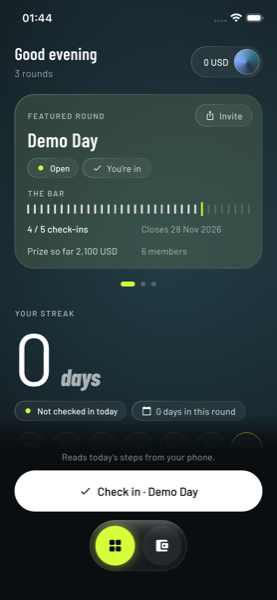
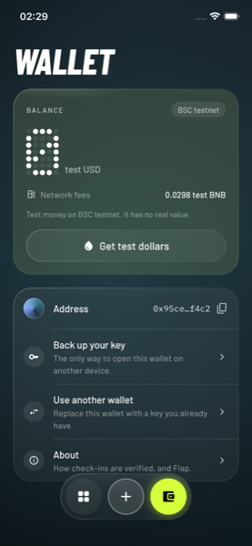
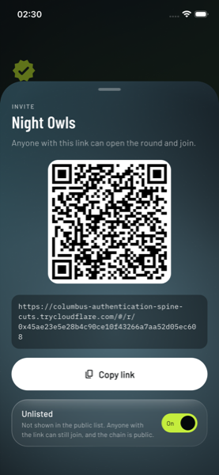

# Cypher Run

People pay a deposit, check in each day they move, and when their check-ins fill one bar, anyone
can launch the round's token through [Flap](https://flap.sh) Pool Launch.

**Try it: https://dokind.github.io/kickoff-bnb-hack/** It runs on BNB Smart Chain testnet with test
money (test BNB and Flap's free-mint test USD). Nothing to install: a wallet is made in the browser.
Nothing here has real value.

Or install the app, which reads today's steps from Apple Health or Health Connect:

- **iPhone:** TestFlight, https://testflight.apple.com/join/bp4WaEu5 (submitted to Apple's beta
  review on 26 November 2026; the link opens once the build is approved).
- **Android 8.0 and later:**
  [cypher-run.apk](https://github.com/dokind/kickoff-bnb-hack/releases/download/android-latest/cypher-run.apk),
  built by GitHub Actions from `main` ([workflow](.github/workflows/android.yml)). Open it on the
  phone and allow installing from the browser. It is signed with a throwaway debug key, so a newer
  build may ask you to remove the old one first.

**Whitepaper:** [docs/WHITEPAPER.md](docs/WHITEPAPER.md)

| Home | Start a round | Wallet | Invite |
|:---:|:---:|:---:|:---:|
|  |  |  |  |

iPhone simulator captures, 26 November 2026, taken before that day's last wording changes. Home
now puts THE PRIZE (what each day shown up is worth) right under the round cards, amounts read
"test USD", and Start round says a launch needs both the check-ins and 1,500 test USD in the token
pool. The invite capture was taken before the web app moved to GitHub Pages, so its link still
shows the earlier tunnel address; invite links now read
`https://dokind.github.io/kickoff-bnb-hack/#/r/<launcher>`.

## How it works

1. A round is one contract, our Launcher, created through the Flap Portal. Everyone pays the same deposit in test USD.
2. Each day you move, you check in: our server signs the day and your wallet records it on chain, once per UTC day.
3. All check-ins fill one bar. When it is full, before the deadline, anyone can launch the round's token through Flap Pool Launch.
4. Part of each deposit (30% by default) plus any sponsor money and half the supply make the token pool; the rest of the deposits is the prize.
5. The prize, the other half of the supply and 80% of the trading tax are shared by days shown up. Goal not reached by the deadline: every deposit goes back.

**What is new about the launch.** Money alone does not launch the token. The launch opens only when
the members have shown up often enough together, counted on chain, and then **anyone** can send the
launch transaction: no operator, no admin, not our server.

## Built on Flap Pool Launch

| What | Address or transaction |
|---|---|
| Our Launcher Factory, `CheckInLauncherFactory` (rounds are created with `Portal.newLauncher`) | [`0x2A872200B83dD025977d785cDE05356d23eA4153`](https://testnet.bscscan.com/address/0x2A872200B83dD025977d785cDE05356d23eA4153) |
| Enabled on the Flap Portal at 1x (`launcherFactoryMultiplier` reads `true, 10000`) | [`0x2a7d7106…d9ad45`](https://testnet.bscscan.com/tx/0x2a7d71063496b439a12248f90b133ce5230d7c9581a25b6af84ede2ec3d9ad45) |
| Our vault factory, `StreakVaultFactory` (the Portal creates each round's vault through it at launch) | [`0x0652AAD1d659344f6EdB9572723479aaece144Be`](https://testnet.bscscan.com/address/0x0652AAD1d659344f6EdB9572723479aaece144Be) |
| Flap Portal (testnet) | [`0x000042108465206185A077Edc3F3fd2b49060000`](https://testnet.bscscan.com/address/0x000042108465206185A077Edc3F3fd2b49060000) |
| First launch, sent by an ordinary member wallet (`launch()` calls `Portal.launchTaxTokenV2`) | [`0xe9d53da5…adb896`](https://testnet.bscscan.com/tx/0xe9d53da5e8ce1bc49e859a42a1f55879a6f056fb3a09b5dca8a9aa55e3adb896) |
| Its token, "Bangkok Showup" | [`0x79F03A11234CFF1Bca37860B29ddb6a7947B7777`](https://testnet.bscscan.com/address/0x79F03A11234CFF1Bca37860B29ddb6a7947B7777), [on Flap's testnet site](https://abc.flap.sh/bnb-testnet/0x79F03A11234CFF1Bca37860B29ddb6a7947B7777) |
| Its vault, which received the prize, half the supply and 183.48 test USD of trading tax, and paid out all the test USD by days (822.32 and 411.16) | [`0x93873812C48C9f5fCD3594fD651Ce9Ce96c75728`](https://testnet.bscscan.com/address/0x93873812C48C9f5fCD3594fD651Ce9Ce96c75728) |

- **What Flap does.** In the one `launch()` transaction the Portal creates the token (1,000,000
  supply, a 3% buy and 5% sell tax, a 30-day `taxDuration`), seeds the PancakeSwap pool with the
  token pool and half the supply, burns the LP, creates our vault through `StreakVaultFactory`, hands it the other half
  of the supply, and routes the tax through two fee slots: a vault slot of 80% and a burn slot of 20%.
- **What we wrote.** The launch condition (a check-in counter, not a raise target), the escrow of
  deposits and sponsor money, refunds, and the vault that pays by days. Flap's base contracts in
  `contracts/src/flap/` are used unmodified.
- **Proof.** Every address, transaction and amount of the first complete round, and what was read
  on 26 November 2026, is in [PROOF.md](PROOF.md).

## Setup

You need [Foundry](https://getfoundry.sh), Node.js 22 or newer, and Flutter 3.41 or newer. Never put
a real key in a file that is committed: each part has a `.env.example` with placeholder names, and
`.env` is git-ignored. Use throwaway testnet keys only.

```sh
# Contracts
cd contracts
./install-deps.sh        # forge-std, OpenZeppelin and solady at pinned commits into lib/
cp .env.example .env     # BSC_TESTNET_RPC_URL; PRIVATE_KEY only when deploying
forge test               # 69 pass; the fork suite is skipped when BSC_TESTNET_RPC_URL is empty
BSC_TESTNET_RPC_URL=https://bsc-testnet-rpc.publicnode.com forge test   # 74, with 5 fork tests

# Server
cd verifier
npm install
cp .env.example .env     # RPC_URL, ATTESTER_PRIVATE_KEY, ADMIN_TOKEN; see the comments in the file
npm run dev              # http://localhost:8787 (the same routes also under /api)
npm test && npm run typecheck

# App
cd app
flutter pub get
flutter analyze && flutter test
flutter run -d chrome --dart-define=VERIFIER_URL=http://localhost:8787
```

`VERIFIER_URL` fixes the server's address for local work. A build without it finds the server
through OriginRegistry (see "Hosting").

## How a round works

One Launcher contract is one round. It is created through the Flap Portal with our own Launcher
Factory (`Portal.newLauncher` with `CheckInLauncherFactory`).

| Step | What happens | Contract call |
|---|---|---|
| **Join** | A wallet pays the round's fixed deposit once, in test USD, and becomes a member. | `CheckInLauncher.join()` |
| **Sponsor** (optional) | Anyone may add test USD. It goes to the token pool only and earns no share. | `sponsor(amount)` |
| **Check in** | A member checks in once per UTC day. Each check-in needs our server's signature for that wallet and day, and adds 1 to the member's days and to the bar. | `checkIn(day, signature)` |
| **Launch** | Once the bar is full (`totalCheckIns >= checkInGoal`) and before the deadline, anyone calls it, once. The token pool gets all sponsor money plus 30% of the deposits (`liquidityBps`, set per round) and half the token supply; Flap burns the LP. The rest of the deposits, the prize, and the other half of the supply go to the round's vault. The token has a 3% buy and 5% sell tax (`taxDuration` 30 days); 80% of the tax flows to the vault and 20% is burned. | `launch()` |
| **Claim** | A member with `d` days receives `d / totalCheckIns` of the reserved tokens, once, and the same fraction of the test USD the vault has received (prize plus trading tax), again whenever more tax has arrived. A member with no days gets nothing. There is no settle step and no list. | `StreakVault.claim()` |
| **Refund** | If the deadline passes without a launch, each member takes the full deposit back and each sponsor their contribution. | `refund()` |

An example with the numbers the tests use: three members at 1,000 test USD, 30% to the token pool.
The pool would get 900, under the 1,500 test USD floor Flap's Portal enforces today, so a sponsor
adds 600. At launch the pool gets 1,500 and the vault gets the 2,100 prize and 500,000 tokens. With
days 3, 2 and 1 the members receive 3/6, 2/6 and 1/6 of the tokens and of the prize plus tax.

## Enforced on chain, and attested by our server

| Enforced by the contracts | Attested by our server |
|---|---|
| Who is a member, and that everyone paid the same deposit once | **That a wallet moved enough on a given day.** The server signs a daily check-in after it accepts a report: steps from Apple Health in the iPhone build, or a number typed in on the web (self-reported, a testnet-only switch). |
| One check-in per wallet per UTC day, for today or yesterday only, members only, closed at launch | |
| The count: `daysOf[wallet]`, `totalCheckIns`, the goal, the deadline | |
| Launch only with a full bar, only before the deadline, only once, callable by anyone | |
| The split: sponsor money plus `liquidityBps` of the deposits to the token pool, the rest to the vault | |
| Claims in proportion to days; refunds in full after a missed deadline | |
| Nobody can withdraw from the Launcher or the vault: not the attester, a sponsor, the creator or the deployer | |

The attester is one address, fixed when the round is created: the key of our server.

- **Check-ins are attested, not proven.** The contract cannot see anyone's activity and takes the
  signature as given. The server can sign for a member who did not move, or refuse to sign for one
  who did, and it cannot verify a step count a client sends. Members rely on the operator of that
  server for this, and for nothing else.
- **What the attester cannot do.** It cannot launch early (the bar needs `checkInGoal` check-ins,
  each from a wallet that paid a deposit, at most one per wallet per day). It cannot block or delay
  a launch once the bar is full (`launch()` is open to anyone). It cannot choose who is paid other
  than by signing or not signing daily check-ins. It cannot move funds: it has no function on
  either contract and receives nothing.
- **If it stops signing**, the bar never fills, and after the deadline everyone is refunded.
- Flap's Guardian can upgrade the Launcher and vault implementations, as in Flap's own example.

## Known limits

Stated plainly, each with what version 2 changes.

- **A member who joins near a full bar can get nothing.** The vault pays by days, and days are
  frozen at launch. If the bar fills and someone launches before a new member's first check-in, that
  member has 0 days: the prize part of their deposit goes to the others and the rest to the token
  pool. When the bar is one check-in from full or already full, the app's join sheet says so and the
  deposit takes a second press, "Join anyway". *v2:* a join cutoff
  and a minimum round length in the Launcher.
- **Reserved tokens are claimable and liquid right after launch.** `claim()` works from the next
  transaction and the tokens can be sold at once, so the first member to sell gets the best price
  from the pool and later sellers less. *v2:* release them over the tax window (the launch's 30-day
  `taxDuration`) through a vault upgrade.
- **The tax share is fixed at launch.** Each member's share of the trading tax is their days before
  launch over all check-ins before launch. Check-ins close at launch, so showing up afterwards earns
  nothing more, and stopping afterwards costs nothing. *v2:* keep counting check-ins during the tax
  window and share the tax by those days.
- **Check-ins are attested by one server key.** Its exact bound, from
  [`contracts/src/CheckInLauncher.sol`](contracts/src/CheckInLauncher.sol): a signature is good for
  one wallet, one UTC day, one round and one chain; the contract takes it only in a transaction sent
  by that member, only for the current or the previous UTC day, at most once per member per day, and
  only before the launch and the deadline. So the key can give a member at most one day for each UTC
  day from the day before they joined to the launch, and can withhold any day. It has no function on
  the Launcher or the vault: it cannot launch, block a launch, or move or receive funds. *v2:*
  attestations through the BNB Attestation Service, a KMS-held key, and a new attester for new rounds.
- **Typed check-ins on the web are a testnet-only switch.** With `ALLOW_SELF_REPORTED=true` the
  server signs a number someone typed. It is how the web demo works and it proves nothing. *v2 and
  mainnet:* off; check-ins from phone health data only, with checks on the source.
- **The attester can sign a day before the round opened.** The contract accepts yesterday whatever
  the round's age. The server signs today only, but the key itself can sign yesterday: in round 1 the
  script signed a check-in for 24 November in a round opened on 25 November
  ([PROOF.md](PROOF.md)). *v2:* the Launcher records its opening day and refuses earlier days.

## What breaks at 10,000 users

| Part | Today | Fix |
|---|---|---|
| Server store | One JSON file (`DATA_FILE`), rewritten whole on each change | Postgres |
| Round and member discovery | Rounds from a log scan of the factory's creation events, in chunks from its deploy block; members are only the wallets this server has seen | An indexer on the factory and each Launcher's events, with paged lists |
| RPC | One public endpoint for the server, and the first of two public endpoints in the app | A paid endpoint with a fallback |
| Attester key | One key in an env var; it signs check-ins, announces the host and, by default, pays the faucet | A KMS-held key; a separate faucet key (`FAUCET_PRIVATE_KEY`, already supported); a new attester for new rounds, which is a per-round setting already |
| Gas faucet | 0.03 test BNB per new wallet from one wallet, 200 wallets in all | Sponsored gas through a BSC paymaster |
| Hosting | A Cloudflare quick tunnel whose host changes on restart | A named tunnel or a VM; the apps already find the host through OriginRegistry, so moving needs no new build |

## Roadmap

- **BNB stack.** Gas sponsored through a BSC paymaster, so a new member needs no test BNB; check-ins
  as attestations on the BNB Attestation Service; a real stablecoin as the quote token on mainnet;
  Flap mainnet after an audit (Flap requires audited, enabled factories there).
- **Rounds that feed rounds.** Round N's tax can seed round N+1's token pool through `sponsor()`,
  which anyone can call today: a member claims and sponsors the next round. A later version could
  send it there directly.
- **Stronger check-ins.** Apple Health workouts and Health Connect sources, one identity per wallet,
  pace and route checks.

## Business model

**Sponsored rounds.** A running club, a race or a brand funds a round's token pool, and the round
sets `liquidityBps` to 0, so 100% of the deposits are prize. The factory accepts any `liquidityBps`
from 0 to 10,000 ([`CheckInLauncherFactory.sol`](contracts/src/CheckInLauncherFactory.sol) refuses
only values above 10,000); `launch()` needs a non-empty pool, so with 0% the sponsor's money is the
pool. Revenue now: a flat fee per sponsored round, charged to the sponsor off-chain. Nothing in the
contracts takes a fee, and no sponsor has paid one yet.

A worked example, with assumed numbers:

| | |
|---|---|
| Round | 30 days, 30 members, 50 test USD deposit, `liquidityBps` 0, goal 400 check-ins |
| Deposits, all prize | 30 × 50 = 1,500 test USD |
| Sponsor (the club) | 1,500 test USD into the token pool, Flap's floor today, plus our flat fee off-chain (200 USD, an assumed price) |
| Check-ins | 20 members show up 20 days each (400, the bar is full); 10 never check in |
| Each of the 20 | 1/20 of the prize, 75 test USD for 50 paid, plus 25,000 tokens and 1/20 of the vault's 80% of the trading tax |
| Each of the 10 | Nothing |

**Version 2.** A treasury slot in a new factory, taken from the tax's burn share: the vault keeps
its 80%, and the 20% that is burned today goes to a treasury instead.

## Parts

```
 web / phone app (Flutter) ──signed daily report──►  server (Node, Hono): the attester
        │                  ◄──attester signature, rounds, streaks, gas faucet──
        │
        │ join, sponsor, checkIn(day, signature), launch, claim, refund
        ▼
  CheckInLauncher ──launch(), anyone──► Flap Portal ──► token + pool + StreakVault
```

| Part | Folder | What it does |
|---|---|---|
| Contracts | [`contracts/`](contracts) | `CheckInLauncherFactory`, `CheckInLauncher`, `StreakVaultFactory`, `StreakVault` (Solidity 0.8.26, Foundry), forked from Flap's Crowd launcher and vault example, and `OriginRegistry`. They hold the deposits, the sponsor money, the reserved tokens and the tax, and apply the rules above. |
| Server | [`verifier/`](verifier) | HTTP server (Hono, viem). Finds every round our factory created from the factory's creation events and serves the list; accepts a member's daily report and signs the check-in for that round; relays what the chain says about each round; keeps streaks and the members it has seen; sends a new wallet 0.03 test BNB once for gas; writes its own host to OriginRegistry. It sends no transaction to the Launcher or the vault. |
| App | [`app/`](app) | One Flutter app, our own UI. Web build: onboarding with a wallet made in the browser, Home with every listed round as cards and one action that follows the round on screen (join, check in, launch, claim, refund), an invite link and QR code per round, sponsor, start a round, wallet. iPhone build: the same, with steps from Apple Health. |
| Scripts | [`scripts/`](scripts) | `deploy-testnet.sh` deploys the factories and prints the app build commands. `run-round.ts` runs one whole round on testnet. |
| Hosting | [`deploy/`](deploy) | The server's compose file and Caddy config. |

Each part's README has the full reference: [`contracts/README.md`](contracts/README.md),
[`verifier/README.md`](verifier/README.md), [`app/README.md`](app/README.md).

## Hosting

- **The web app is on GitHub Pages** at https://dokind.github.io/kickoff-bnb-hack/ (base path
  `/kickoff-bnb-hack/`, hash routes). A round's invite link is
  `https://dokind.github.io/kickoff-bnb-hack/#/r/<launcher>`.
- **The server stays where it is**, reached through a Cloudflare quick tunnel whose host changes
  when the tunnel restarts.
- **The server announces its host on chain.** [`OriginRegistry`](contracts/src/OriginRegistry.sol)
  at [`0xb9aD45Dc177C801f10670F2aac03B467f1C367d2`](https://testnet.bscscan.com/address/0xb9aD45Dc177C801f10670F2aac03B467f1C367d2)
  holds one string, `origin()`, which only the attester key can set. With `ORIGIN_REGISTRY` set, the
  server finds its public host (`ORIGIN_HOST`, or the tunnel's own report) every 60 seconds and sends
  `setOrigin(host)` when the two differ.
- **The apps read it.** Before their first call they read `origin()` and call
  `https://<host>/api`, and they look again when a call cannot reach the server. No build has the
  tunnel host baked in.
- The registry holds no funds and gates nothing: a wrong value can only send the apps to a server
  that cannot sign check-ins for any round.

The server needs `ALLOW_SELF_REPORTED=true` for check-ins typed in a browser and
`FAUCET_ENABLED=true` for the gas faucet.

## Deployed on BSC testnet

Deployed 25 November 2026 from `0xc1bD6aC9311b9345ae8023201875518429c8BF58`; the record is
[`contracts/deployments/bsc-testnet.json`](contracts/deployments/bsc-testnet.json).

| Contract | Address | Deployment transaction |
|---|---|---|
| `CheckInLauncherFactory` (our Launcher Factory) | [`0x2A872200B83dD025977d785cDE05356d23eA4153`](https://testnet.bscscan.com/address/0x2A872200B83dD025977d785cDE05356d23eA4153) | [`0x827f9b4e404217a35e75fbef0f9ea0012f1c3e0d490ac87a88e31c44079c094c`](https://testnet.bscscan.com/tx/0x827f9b4e404217a35e75fbef0f9ea0012f1c3e0d490ac87a88e31c44079c094c) |
| `StreakVaultFactory` | [`0x0652AAD1d659344f6EdB9572723479aaece144Be`](https://testnet.bscscan.com/address/0x0652AAD1d659344f6EdB9572723479aaece144Be) | [`0x19a6d3aa23f2d6e5458965070462f1411a62256d67403f8127232b4fa1deb2a6`](https://testnet.bscscan.com/tx/0x19a6d3aa23f2d6e5458965070462f1411a62256d67403f8127232b4fa1deb2a6) |
| `OriginRegistry` (26 November 2026) | [`0xb9aD45Dc177C801f10670F2aac03B467f1C367d2`](https://testnet.bscscan.com/address/0xb9aD45Dc177C801f10670F2aac03B467f1C367d2) | [`0x0387d2b0e7a84d0a6b72f26d2fdd8ebc4fadd0bfb7620aa7cd231f4498596098`](https://testnet.bscscan.com/tx/0x0387d2b0e7a84d0a6b72f26d2fdd8ebc4fadd0bfb7620aa7cd231f4498596098) |

The Launcher Factory is enabled on the Flap Portal at the standard 1x multiplier:
`launcherFactoryMultiplier(0x2A87…4153)` reads `true, 10000`. It was enabled on 26 November 2026
through Flap's testnet helper `0x77779969a11eff7582f3bCf48135A846A3457777` in
[`0x2a7d71063496b439a12248f90b133ce5230d7c9581a25b6af84ede2ec3d9ad45`](https://testnet.bscscan.com/tx/0x2a7d71063496b439a12248f90b133ce5230d7c9581a25b6af84ede2ec3d9ad45).
Anyone can call that helper for any factory, so read the value back before a demo
([DEMO.md](DEMO.md) has the command).

| Fixed address | |
|---|---|
| Attester (our server's key; also the faucet wallet unless `FAUCET_PRIVATE_KEY` is set; the only address OriginRegistry accepts) | `0x2F2ab3dA0b824F9cA3EdD2580443Ca0b271EfDD7` |
| Flap Portal | `0x000042108465206185A077Edc3F3fd2b49060000` |
| Test USD (quote token, 18 decimals, anyone can mint) | `0x190C989D5665a0e404B444b53CAE9AbCfb600157` |

Four rounds have been opened with these factories on testnet (the factory's
`CheckInLauncherCreated` events, read on 26 November 2026):

| Round | Launcher | Created by | State on 26 Nov 2026 |
|---|---|---|---|
| "Bangkok Showup" | `0xe1c165C295ED8bC0abA2a81c2a524564689BCeAB` | `scripts/run-round.ts` (the deployer wallet) | launched, 3 of 3, every claim paid |
| "Demo Day" | `0x378d729aE7122e5Cf7d6f4ed8797710d2503EDb5` | `scripts/run-round.ts` (the deployer wallet) | open, 4 of 5, 6 members (two with 0 days), the server's featured round |
| "morning movers" | `0x74B9218cC901fa4b295C3B021c246E6f1022915B` | the app's "Start a new round", wallet `0x580d21E31B49D8D21AD1d4E79F676142577e2997` | open, 0 of 6, 1 member |
| "Night Owls" | `0x45ae23e5e28b4c90ce10f43266a7aa52d05ec608` | the app's "Start round", wallet `0x95Ced7B6D811509F8741c1C5B352353f3Ff8F4C2` | open, 0 of 6, no members yet, unlisted |

Every address and transaction of the first two, and the creation of "Night Owls", is in
[PROOF.md](PROOF.md).

## Many rounds, round links and unlisted rounds

- **Every round is found on chain.** The server reads the factory's creation events from the block
  the factory was deployed in (144816444), keeps what it found in its store and looks again every
  10 seconds. Nobody has to tell it about a new round.
- **Home shows the listed rounds as cards.** The server's featured round comes first, then rounds
  this wallet has joined, then open rounds by nearest deadline, launched ones and ended ones. The
  streak, the action button, the prize and the members under the cards belong to the card on screen.
- **A round has a link**: `https://dokind.github.io/kickoff-bnb-hack/#/r/<launcher>`. Opening it
  selects that round. The "Invite" sheet shows the link, a copy button and a QR code.
- **A round can be unlisted.** Starting a round has an "Unlisted" switch; the creator's wallet
  signs the choice and the server keeps it. Unlisted means exactly this: the round is not shown in
  the app's public list. Anyone with the link can still open and join it, and anyone reading the
  chain can find it. It is not hidden data.
- **When a new round appears in the list.** At once when its creator's app registers it as listed;
  never when it is registered as unlisted; otherwise three minutes after its creation, so a round
  whose creator is about to register it as unlisted is not shown in between.
- **The featured round** is the one set with `CURRENT_LAUNCHER` or `POST /admin/round`. The earlier
  single-round routes (`/round`, `/me/:address`, `/members`, `/checkin`) still answer for it, so
  app builds from before this change keep working.

## What the three parts agree on

Checked by tests on each side and by the fork run described under "Status".

- **Round config.** `Portal.newLauncher(factory, abi.encode(config))`, where `config` is one tuple
  `(string name, string symbol, string meta, bytes32 salt, uint256 deposit, uint256 liquidityBps, uint256 checkInGoal, uint256 deadline, address attester)`.
  The same 480-byte vector is pinned in `contracts/test/CheckInLauncher.t.sol` and
  `app/test/services_test.dart` and equals `cast abi-encode` of the tuple. The salt is mined from a
  random start so the token address ends in `0x7777`.
- **Check-in signature.** `inner = keccak256(abi.encode(uint256 chainId, address launcher, address wallet, uint256 day))`
  with `day = unix time / 86400`; the attester signs `inner` with personal_sign (EIP-191), 65 bytes.
  One worked vector is pinned in the contracts' test, reproduced byte for byte by
  `verifier/test/attest.test.ts`, and the app's `checkIn(day, signature)` calldata for it equals
  `cast calldata`.
- **Texts a member signs** (personal_sign): `Cypher Run checkin <launcher> <YYYY-MM-DD> <steps>`,
  `Cypher Run faucet <address>` and, by a round's creator only,
  `Cypher Run round <launcher> <listed|unlisted>`. The app writes addresses in lower case; the server
  accepts lower case or checksummed. The round text carries no date: someone who has seen a
  creator's signature could send it again, which only sets that same choice again. The product name
  is one constant in the server and one in the app (`verifier/src/product.ts`, `app/lib/config.dart`);
  renaming it changes the signed texts on both sides. `contracts/src/Product.sol` still says
  "Showup", the working name: it is only used in the description the deployed contracts report, and
  they were not redeployed.
- **API.** `GET /rounds` (the listed rounds), `POST /rounds` (the creator lists or unlists a round),
  and per round `GET /rounds/:launcher`, `GET /rounds/:launcher/me/:address`,
  `GET /rounds/:launcher/members`, `POST /rounds/:launcher/checkin`. For the featured round the
  earlier `GET /round`, `GET /me/:address`, `GET /members`, `POST /checkin` answer the same. Also
  `GET /stats`, `GET /health`, `POST /faucet` and `POST /admin/round`. Every route is also under
  `/api`. Amounts are decimal strings in whole tokens. The apps call `https://<host>/api`, with the
  host read from OriginRegistry.
- **Days are UTC** everywhere. The server signs for today only; the contract also accepts yesterday.
- **Transactions** are legacy type at 1 gwei with explicit gas limits, from the app, the server and
  the scripts. Fee estimation on this testnet answers 1 wei and such transactions are never mined.
  `launch()` uses about 5,000,000 gas; the limit is 7,000,000.
- **Flap's pool floor.** The Portal refuses a launch whose token pool is under 1,500 test USD today
  (Flap can change it). `poolQuoteNow()` shows what the pool would get; below the floor `launch()`
  reverts and nothing changes, so a sponsor can top up and anyone can call it again.

## Deploy

The factories and the registry are already deployed (addresses above). To deploy the factories again:

```sh
scripts/deploy-testnet.sh --dry-run   # simulates the deploy; sends nothing, writes nothing
scripts/deploy-testnet.sh             # asks, then deploys the two factories (about 0.014 test BNB)
scripts/deploy-testnet.sh --print     # prints the app commands for the last deploy again
```

It runs `forge script script/Deploy.s.sol --rpc-url bsc_testnet --broadcast --slow --legacy
--with-gas-price 1000000000` from `contracts/`, checks that both factories have code, and prints the
app build commands. The web build for GitHub Pages:

```sh
cd app
flutter build web --release --base-href /kickoff-bnb-hack/ \
  --dart-define=CHECKIN_LAUNCHER_FACTORY=0x2A872200B83dD025977d785cDE05356d23eA4153 \
  --dart-define=STREAK_VAULT_FACTORY=0x0652AAD1d659344f6EdB9572723479aaece144Be \
  --dart-define=ATTESTER_ADDRESS=0x2F2ab3dA0b824F9cA3EdD2580443Ca0b271EfDD7
```

`ATTESTER_ADDRESS` must be the address of the server's key (`ATTESTER_PRIVATE_KEY`, or the earlier
name `VERIFIER_PRIVATE_KEY`, in `verifier/.env`). A round created with another attester cannot get
check-ins signed by this server, and this server leaves it out of the public list.

## Demo

The six steps in the app, and the checklist before going on stage, are in [DEMO.md](DEMO.md).

**A whole round by script.** With the server running (hosted or `npm run dev`) and
`ALLOW_SELF_REPORTED=true`:

```sh
cd verifier && VERIFIER_URL=https://<host>/api npx tsx ../scripts/run-round.ts
```

It opens a round with the deployer key, points the server at it, funds three throwaway members who
join with 1,000 test USD each, sponsors the 600 the pool is short of, checks two of them in through
the server (source "self"), launches from a member wallet, trades on the pool so tax reaches the
vault, and claims. The member who never checked in is shown to get nothing. Settings and the
two-day variant (`CHECKIN_GOAL=3`, a 2 : 1 : 0 split) are at the top of
[`scripts/run-round.ts`](scripts/run-round.ts). The step counts it reports are made up by the
script and sent as self-reported; everything on chain is real.

Things to know before a demo: days are UTC, so a new day starts at 07:00 in Bangkok and one wallet
can check in once per day; the token pool must reach 1,500 test USD (five members at 1,000, or
fewer plus a sponsor); the iPhone build counts steps since 00:00 UTC against the server's
`MIN_STEPS` (1,000).

## Status

Checked on 25 November 2026; the many-rounds lines and the phone build line on 26 November 2026;
the test counts, the hosting lines and the chain reads in [PROOF.md](PROOF.md) on 26 November 2026
(Bangkok).

Done and checked:

- **Contracts.** 74 tests pass with a BSC testnet RPC (5 of them whole rounds against the live
  Portal on a fork, 6 for OriginRegistry), 69 pass without one with the fork suite skipped. The two
  factories and the registry are deployed on BSC testnet; the Launcher factory reads back its paired
  vault factory, the Portal and the test USD token, and the registry's `announcer()` is the attester.
- **Server.** 171 tests in 10 files pass and the strict typecheck passes (run 26 November 2026,
  while the origin announcer and the separate faucet key were being added).
- **App.** `flutter analyze` is clean and 416 tests pass, with one more (the fork test) skipped
  unless it is given a fork (run 26 November 2026).
- **Many rounds, on the hosted server.** The factory's creation events named three rounds and
  `/api/rounds` listed the same three, including "morning movers", which was started from the app.
  Every field the server reported for each equalled a direct chain read. The app's own client read
  the routes from the real server code, and the signature the app makes for
  `Cypher Run round <launcher> <listed|unlisted>` recovers to the signer under the server's text.
- **All three together, on a local fork of BSC testnet taken after the deploy** (the deployed
  factories themselves, the real server code with its real key, no mocks; nothing sent to the real
  testnet):
  - `scripts/run-round.ts` ran a whole round: open through the Portal, three joins, a 600 sponsor,
    two check-ins signed by the server and accepted by the contract, `launch()` refused while the
    bar was short and then sent by a member (4.64M gas), a claim straight after launch, trading,
    37.17 test USD of tax to the vault, and final claims of 1,068.59 test USD and 250,000 tokens
    each for the two members who checked in. The Launcher was left holding nothing.
  - A second round was left one check-in short and finished by the app's own state and service code
    (`app/test/fork_e2e_test.dart`): a new wallet got gas from the server's faucet, minted the
    deposit, joined, checked in, launched and claimed, and the numbers from the server and from the
    chain agreed at every step.
- **Two rounds on the real testnet, against the hosted server** ([PROOF.md](PROOF.md)). Round 1
  ran from open to the last claim: three joins at 500 test USD, a 1,050 sponsor, three check-ins
  (days 2, 1 and 0), `launch()` sent by a member (4.64M gas), 183.48 test USD of trading tax to the
  vault, and claims of 2/3 and 1/3. The server's `/api/round` and `/api/me` matched the chain at
  each of nine stages. Round 2 ("Demo Day") was left open with the bar at 2 of 5; on 26 November
  it stood at 4 of 5 with 6 members and is the server's featured round. The trading tax was
  dispatched to the vault by an outside account within a few blocks of each sale; the script did
  not have to call `dispatch()`.
- **A round started from the app with the unlisted switch**: "Night Owls", created on 26 November
  2026 (Bangkok) from a wallet made by the app ([PROOF.md](PROOF.md)).

Not done or not checked:

- The check-ins in both testnet rounds of PROOF.md were self-reported test entries from throwaway
  wallets made by `scripts/run-round.ts`, and one of them (round 1, for the day before) was signed
  by the script with the attester key and not through the server. [PROOF.md](PROOF.md) says which.
- The fork test drives the app's state and services, not the screens.
- **OriginRegistry has not been written yet**: on 26 November its `origin()` was empty and
  `updatedAt()` 0. The web app was not yet answering at its GitHub Pages address when this README
  was written.
- The iOS app builds for the simulator and for a device, and the screenshots above are from the
  simulator. Reading steps from Apple Health was not tried on a device, and the Android build was
  not built.
- Whether the faucet has paid on the real testnet was not checked transaction by transaction. The
  attester wallet's nonce read 9 on 26 November, against 4 when PROOF.md was first written; that
  wallet is also the faucet's.
- Step counts are whatever the client sends, signed by the member's key. The server cannot check
  that they came from health data, and on the web they are typed in.
- Whether Flap takes a protocol fee out of the tax before the 80 / 20 split was not measured.
- The Chinese text in the Launcher's on-chain description was not reviewed by a native reader.
- No audit. Testnet tokens only.

## Credit

- The contracts are a fork of the Crowd launcher and vault example in
  [flap-sh/FlapPoolLaunchVaultExample](https://github.com/flap-sh/FlapPoolLaunchVaultExample)
  (commit `29334f689774f6b3a39720b3fc802ab0d6a61718`). Everything under `contracts/src/flap/` is
  copied from that repository unmodified and is MIT, as its source headers say
  (`SPDX-License-Identifier: MIT`). Details are in [`contracts/README.md`](contracts/README.md).
- The look of the app follows a teammate's (Delgersaikhan's) earlier SwiftUI prototype, used as the
  visual reference: its screens, layout, type and motion were rebuilt in Flutter. None of its code
  is used.
- The app shows Flap's logo once, small and unchanged, next to "Built on Flap"; Cypher Run is not
  run or endorsed by Flap. Sources and the media kit's rules are in
  [`app/assets/brand/README.md`](app/assets/brand/README.md).
- The earlier design (running club seasons) is kept as a record in
  [docs/archive/PROOF-club-season.md](docs/archive/PROOF-club-season.md) and
  [docs/archive/DEMO.md](docs/archive/DEMO.md); `scripts/run-season.ts` is the script behind it.
- Built at BNB Hack Bangkok, November 2026, for Flap's track "invent a new way to launch a token on
  Flap Pool Launch".

## License

[MIT](LICENSE), copyright 2026 dokind.
