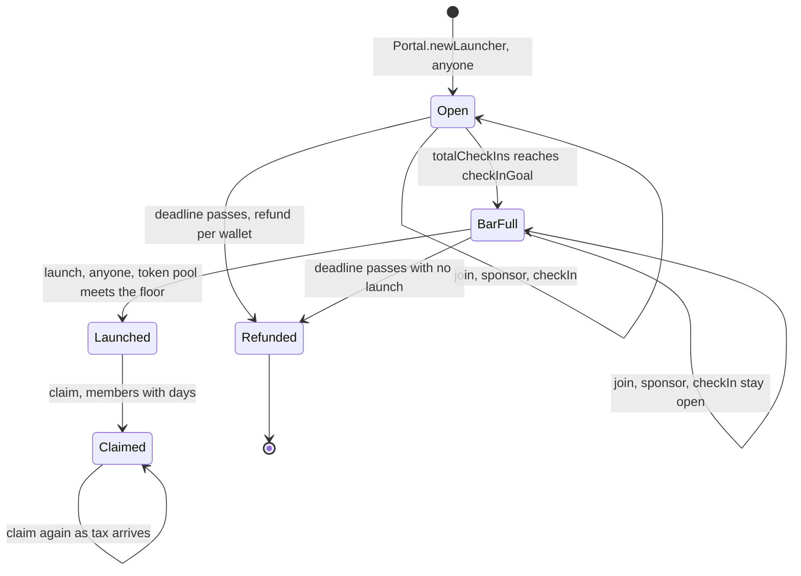
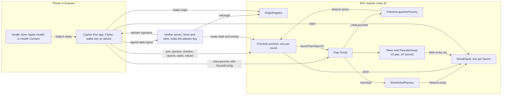
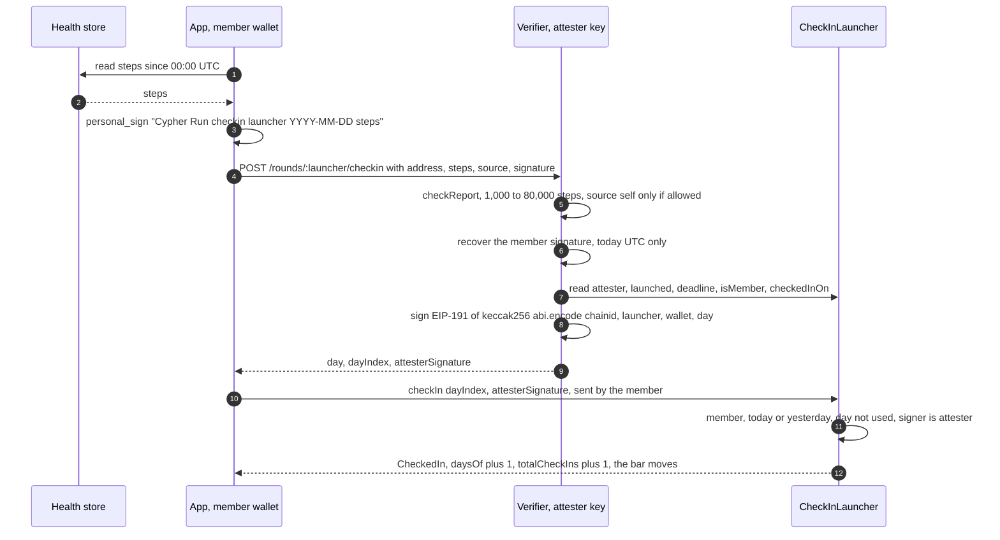
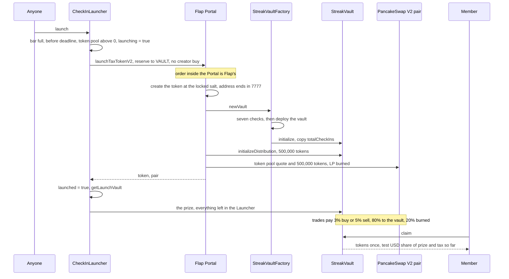

# Cypher Run whitepaper

Cypher Run turns showing up into a community, and a community into a launch: a round where days
shown up, not money raised, open a coin launch on Flap Pool Launch. The pot is safe; the launch is
the bonus.

BSC testnet only (chain 97). Every amount here is test USD or test BNB and has no value. Every rule
below is cited to the contract, server function or record that enforces or shows it:
[`contracts/src`](../contracts/src), [`verifier/src`](../verifier/src) and [PROOF.md](../PROOF.md).
Contract citations are `file:line` in this repository; `:N` alone means `CheckInLauncher.sol:N`.

| | |
|---|---|
| Web app | https://dokind.github.io/kickoff-bnb-hack/ |
| iPhone (TestFlight; build 202611261356 is in Apple's beta review, and the link opens only after Apple approves the beta) | https://testflight.apple.com/join/bp4WaEu5 |
| Android | https://github.com/dokind/kickoff-bnb-hack/releases/download/android-latest/cypher-run.apk |
| Source (MIT) | https://github.com/dokind/kickoff-bnb-hack |
| Proof on testnet | [PROOF.md](../PROOF.md) |

## 1. Abstract

Cypher Run is a commitment round with a deposit on it. Members pay the same deposit in test USD,
check in on each day they move, and every check-in fills one shared bar. A round has two endings.
If it has not launched by its deadline, every member presses Refund and gets back 100% of the
deposit, whatever their days. If the bar reaches its goal first, anyone can launch the group's own
coin through Flap Pool Launch, and the group's piggy bank (the round's vault) is split by days shown
up, not by dollars.

The round is a Flap Launcher, created by our own Launcher Factory, which is enabled on Flap's BSC
testnet Portal. The launch mints 1,000,000 coins. Half seed a PancakeSwap pool (the shop) with the
pool money, and the LP tokens are burned. The other half, the prize and 80% of the 30-day trading
tax go to the vault, which pays members in proportion to their days; the other 20% of the tax is
burned. The pool money is all sponsor money plus a set share of the deposits (`liquidityBps`, 30%
by default). In a sponsored round that share is 0%: every deposit is prize, the deposit never
touches the coin, and a member who keeps up with the average gets at least the whole deposit back
(section 6). Without a sponsor, a club builds its own shop from its deposits (section 7).

A complete round ran on BSC testnet on 25 November 2026: three member wallets, a member-sent launch,
trading tax, and claims of 822.32, 411.16 and 0 test USD for 2, 1 and 0 days. That is the deposits
and the tax split by days, not a return: the tax came from our own test trades.

## 2. The problem

Most people who start a habit stop within weeks. Two tools are known to help, and each fails alone.

- **Stakes without a group.** Deposit apps take your money and return it if you keep a streak. You
  are alone with a timer, the operator holds the money, and the operator decides who kept the
  streak.
- **A group without stakes.** Running clubs and step challenges give you people to show up for,
  but missing a day costs nothing.

Cypher Run puts both in one contract. The deposit is the stake. The bar is the shared goal: nobody
reaches it alone, and every member can see how far the group is. Each day you show up moves the
bar and raises your share.

**Why a coin launch is the reward and the finish line.** A launch is an event everyone in the
round can watch arrive, so it works as the finish line. It also turns the round into something that
keeps paying after it ends: the coin trades, and for 30 days 80% of its trading tax flows to the
members who showed up, by their days. A plain escrow contract can only hand back what quitters
lost; one Pool Launch call adds a coin, a shop nobody can empty and 30 days of tax for the group.

## 3. Why Flap Pool Launch

### 3.1 A programmable launch condition

One new rule for Pool Launch: no community, no coin. Pool Launch lets a Launcher decide what unlocks
a launch. Flap's own example Launcher opens on money raised. We forked it, set the raise target to 0,
and open on days shown up. Our Launcher reports no raise target (`targetRaise = 0`, `:218-225`), and `launch()`
opens only when `totalCheckIns >= checkInGoal` (`:355`), for anyone, until the deadline. Money is
still needed: the shop must reach Flap's floor (1,500 test USD at our factory's 1x multiplier, a
Portal rule Flap can change), and below it the launch reverts and nothing changes (section 10). But
money alone never opens the launch.

### 3.2 Who it is good for (three beneficiaries)

1. **For members:** a free bonus on top of a safe pot: coins and a 30-day tax stream, paid for by
   the sponsor, not by them. In a sponsored round the shop money is sponsor money only
   (`poolQuoteNow() = totalSponsored + totalDeposits * liquidityBps / 10000`, `:247`, with
   `liquidityBps = 0`), so every deposit reaches the piggy bank as prize (`:380, :385`).
2. **For sponsors:** a race or brand doesn't just pay a prize. It launches its community's coin,
   with a crowd that has already proven it shows up, and a shop nobody can drain: the LP is burned,
   so nobody can pull the pool's liquidity, and trading still works. Sponsor money is spent only if
   the round launches; otherwise the sponsor takes it all back with `refund()` (`:434-438`).
3. **For Flap:** on any launchpad, most new coins fade because there's no real community behind
   them. Ours can't launch until a community exists: N days of people showing up is the launch
   condition. That's a quality filter no money target can give. Every launch needs `checkInGoal` attested check-ins, at
   most one per member per UTC day, each from a wallet that paid a deposit (`:323-340`): a Season
   squad's coin needs 240 of them.

### 3.3 Community first, coin second

On most launches the coin comes first and the community, if it ever comes, comes after, and the
earliest buyers get the best price. Flap's classic launch climbs a price ladder (a bonding curve: the price rises with
each buy). That is a fair way to price a coin that has no group yet, and Flap built it. Pool Launch
skips the ladder: one transaction makes the coin, fills a PancakeSwap shop and burns the LP. That is
what lets a group that already exists launch together.

Here the community comes first. You can't buy into the group's coins; you earn them by showing up:
the 500,000 coins for the group go straight to the piggy bank (`:361-364`) and are claimed by days
(`StreakVault.sol:127`). And for 30 days, every buy and sell pays the people who showed up: 80% of the
3% buy tax and 5% sell tax goes to the group's piggy bank (`:399-401`, `:409-421`).

**A fair launch.** No presale, no team or creator coins, no sponsor coins (`noCreatorBuy`, `:365`).
50% of the coins go to the group by days, 50% sit in the locked shop (`:87-89`). Nobody else is
given coins, us included.

### 3.4 What crypto adds, and what Pool Launch adds on top

| Fundamental | No crypto | With a smart contract | With Flap Pool Launch |
|---|---|---|---|
| Escrow | A company account | A contract with no owner and no withdraw function (`:79-81`) | Same, and money moves only to the shop, the piggy bank or a refund |
| Payout | A company process | A formula plus Claim (`StreakVault.sol:124-148`) | Same, plus coins and tax |
| Who presses | The company | Anyone | Anyone, at a full bar (`:352-356`) |
| What ends it | A date | A date | The group's days (`:218-225, :355`) |
| After | Nothing | Nothing | A coin, the LP burned, 30 days of tax |
| Composability | – | – | One `launchTaxTokenV2` call (`:371`) |

## 4. How a round works

One `CheckInLauncher` contract is one round. Its lifecycle, with who may call what:



`BarFull` is not a stored flag: it is `totalCheckIns >= checkInGoal`, read by `canLaunch()`.

| Call | Who | When | Source |
|---|---|---|---|
| `Portal.newLauncher(factory, abi.encode(RoundConfig))` | anyone, paying the 0.005 test BNB salt lock fee | any time | `CheckInLauncherFactory._newLauncher`, `CheckInLauncher.initialize` |
| `join()` | any wallet, once | not launched, `block.timestamp <= deadline` | `CheckInLauncher.join` |
| `sponsor(amount)` | anyone, any number of times | same as join | `CheckInLauncher.sponsor` |
| `checkIn(day, signature)` | a member, once per UTC day | not launched, before the deadline, day is today or yesterday | `CheckInLauncher.checkIn` |
| `launch()` | anyone, once | `totalCheckIns >= checkInGoal`, `block.timestamp <= deadline`, token pool above 0 | `CheckInLauncher.launch` |
| `claim()` | a member with days | any time after the launch | `StreakVault.claim` |
| `refund()` | a member or sponsor | `block.timestamp > deadline` and not launched | `CheckInLauncher.refund` |

The factory refuses a round whose deadline is in the past or more than 90 days away
(`MAX_ROUND_DURATION`), whose deposit or goal is 0, whose `liquidityBps` is above 10,000, or whose
attester is the zero address (`CheckInLauncherFactory.sol:74-81`). A UTC day is
`block.timestamp / 86400` (`currentDay()`).

## 5. Money

**Symbols.**

| Symbol | Meaning | On chain |
|---|---|---|
| `d` | deposit, the same for every member | `deposit()` |
| `n` | members | `memberCount()` |
| `b` | liquidity share of the deposits, basis points | `liquidityBps()` (app default 3000; 0 in a sponsored Season) |
| `s` | sponsor money, summed | `totalSponsored()` |
| `C` | all check-ins at launch | `totalCheckIns()`, copied into the vault |
| `c_i` | days shown up by member `i` | `daysOf(member)` |
| `S` | token supply | `TOTAL_SUPPLY` = 1,000,000 tokens |
| `T` | trading tax the vault has received | part of `quoteReceived()` |

**At launch** (`poolQuoteNow()`, `launch()`; all divisions round down):

```
token pool   P = n*d*b/10000 + s                      quote into the PancakeSwap V2 pair
                 with S/2 = 500,000 tokens             (POOL_TOKEN); Flap burns the LP
prize        R = n*d - n*d*b/10000                    sent to the StreakVault in the same tx
reserve        S/2 = 500,000 tokens                   handed to the StreakVault by the Portal
```

`R` is computed as the Launcher's whole remaining balance after the Portal pulls `P`
(`prize = quote.balanceOf(address(this))`), so the pool and the prize always add up to everything
the Launcher held (`test_launch_poolAndPrizeAlwaysAddUpToTheDeposits`), and test USD sent to the
Launcher by mistake becomes prize (`test_launch_strayQuoteSentToTheLauncherBecomesPrize`).

**Claims** (`StreakVault.claimable`, `claim`). Member `i` can claim:

```
tokens       (S/2) * c_i / C                          once, on the first claim
test USD     Q * c_i / C  -  already paid to i        again whenever Q grows
             where Q = R + T = quoteReceived() = balance + totalQuotePaid
```

**Trading tax.** 3% on buys and 5% on sells (`buyTaxRate = 300`, `sellTaxRate = 500`,
`taxDuration = 30 days`, in `_buildParams`). The fee slots (`_feeConfigs`) send 80% of the tax to
the vault (`VAULT_TAX_BPS = 8000`) and 20% to a burn (`DEFLATION`). The vault's part is shared by
the same `c_i / C`. Whether Flap takes a protocol fee before this split was not measured. Tax exists
only while people trade, and only for 30 days.

**The 100% refund, exactly** (`refund()`, `:430-449`; `refundable()`, `:264-268`).

- It opens strictly after the deadline (`block.timestamp > deadline`; `launch()` is still allowed
  at the deadline second itself) and only if the coin never launched (`:432`): the bar was not
  full, or the shop was below Flap's floor, or nobody pressed Launch
  (`test_refund_evenWhenTheBarWasFullButNobodyLaunched`).
- Each wallet presses Refund itself, once, with no time limit, and pays a small test-BNB network
  fee (at most about 61,000 gas in the contract tests' gas report). It is not automatic.
- It pays exactly what that wallet put in: `d` for a member, plus everything it sponsored. The
  same with 0 days or every day. Nothing is kept by anyone and nothing is added.
- It pays only `msg.sender` (`:447`): nobody can take anyone else's refund, and a lost key cannot be
  pressed for by anyone else. There is no early exit before the deadline.
- If the coin launched, there is no refund: the piggy bank is split by days.

**Zero days.** A member with `c_i = 0` at launch gets nothing back: no test USD, no tokens, no
tax. `claimable` returns `(0, 0)` and `claim` reverts with `NothingToClaim`
(`StreakVault.sol:126`). Their deposit, less its liquidity part, is in the prize, shared by the
members who showed up. When what is left of the goal is no more than one check-in per member (the
bar can fill today), the app's join sheet says so and the deposit takes a second press, "Join
anyway". If the round never launches, the same member gets 100% back, like everyone else.

### Worked example: Bangkok Showup

Real numbers from [PROOF.md](../PROOF.md), Launcher `0xe1c165C295ED8bC0abA2a81c2a524564689BCeAB`.

```
n = 3, d = 500, b = 3000, s = 1,050           C = 3, days: Ana 2, Ben 1, Chai 0

deposits     n*d            = 3 * 500              = 1,500 test USD
liquidity    n*d*b/10000    = 1,500 * 3000 / 10000 =   450
token pool   P = 450 + 1,050                       = 1,500  (meets Flap's 1,500 floor)
prize        R = 1,500 - 450                       = 1,050
tax          T = 37.173735354404480852 + 53.54428161520104926
               + 48.565917682085283203 + 44.196626614586630826
                                                   = 183.480561266277444141
vault total  Q = 1,050 + 183.480561266277444141    = 1,233.480561266277444141

Ana   Q * 2/3 = 822.320374177518296094   (700 at her first claim, 122.320374177518296094 later)
Ben   Q * 1/3 = 411.160187088759148047   (350 of prize + 61.160187088759148047 of tax)
Chai  0                                  (0 days)

tokens: Ana 500,000 * 2/3 = 333,333.333333333333333333
        Ben 500,000 * 1/3 = 166,666.666666666666666666
        1 smallest unit stays in the vault from rounding down
```

Ana's first claim came straight after the launch, when `Q` was 1,050: `1,050 * 2/3 = 700`. Her
second claim paid `Q * 2/3 - 700`. The vault paid out 822.320374177518296094 + 411.160187088759148047
= 1,233.480561266277444141, exactly what it received, and holds 0 test USD (read on 26 November:
`quoteReceived()` and `totalQuotePaid()` both 1,233.480561266277444141). Each wallet paid 500. Ana's
822.32 test USD and Ben's 411.16 are the 1,050 prize (from all three deposits, Chai's included) and
the 183.48 of tax (all of it from our own 17 test swaps), split by days: a split, not a gain. The
sponsor's 1,050 went into the token pool and earned no share. The same round sponsored with 0% to
the shop would have paid 1,000, 500 and 0 before tax: Ben, at the average of 1 day, gets exactly his
deposit back.

## 6. Seasons and the Keep-Up Guarantee

A **Season** is one sponsored event with one set of dates, made of **squads of 10**. Each squad is
its own round: one `CheckInLauncher`, one bar, one piggy bank, one coin. Squads exist because the
goal is fixed when a round is created (`:201`), so the head count must be known: 10 makes the goal
fillable and the scarcity real. Season 1 is called "Show Up 30" and carries two named promises, the
**Keep-Up Guarantee** and the **Fall-Short Refund**. Its first squad, "Season 1 Squad A", was created
and sponsored on BSC testnet on 26 November 2026, before check-ins start on 1 December 2026
([PROOF.md](../PROOF.md), "Season 1 Squad A"; in the app: [Join Squad A · starts Tue 1 Dec](https://dokind.github.io/kickoff-bnb-hack/#/r/0xa60e2f022d891dd394415a594c9e33614c019153)).
It is not featured before judging.

### 6.1 Season 1 rules

| Rule | Season 1 value | Enforced by |
|---|---|---|
| One event | One or more squads with identical dates; each squad is one Launcher | Operator and server settings |
| Start day | Everyone starts at 0. The first check-in day is Tue 1 Dec 2026 (UTC day 20788). Pre-season joiners hold a deposit at 0 days. | **Server rule** (section 6.5). The contract has no start date (`:287-297, :323-340`). |
| Check-in days | 1 to 30 Dec (days 20788 to 20817): 30 days, 6 rest days at the goal pace. One check-in per wallet per UTC day; a day starts at 07:00 in Bangkok. | Contract (`:327-329`) and server (no signature after 30 Dec) |
| Squad size | 10. The app stops offering Join at 10 members and a new squad opens when one fills. A join sent straight to the contract still works. | App |
| Goal | 10 × 30 days × 0.8 = **240**. Earliest fill: day 24 (24 Dec) if all 10 check in every day. A squad needs at least 8 members to be able to fill (8 × 30 = 240). | Contract, fixed at creation (`:201`) |
| Join window | In the app until the end of Mon 7 Dec (UTC day 20794): a day-7 joiner can still reach 24 days. The contract takes joins until the launch or the deadline (`:289`). | App |
| Launch | Opens when the bar is full (`:355`), for anyone, until the deadline. Earliest 24 Dec, latest 31 Dec: not a fixed date. If the bar is full and nobody has launched by 31 Dec 12:00 UTC, the operator presses Launch. | Contract; the operator's step is in [DEMO.md](../DEMO.md) |
| Deadline | 31 Dec 2026 23:59:59 UTC = `1798761599`, about 35 days after creation, inside the 90-day cap (`CheckInLauncherFactory.sol:32, :79`) | Contract |
| Refund | From Fri 1 Jan 2027 00:00 UTC (07:00 in Bangkok), only if not launched (`:432`). Season 2 opens the same day. | Contract |
| Config | Deposit 100 test USD, `liquidityBps` 0, sponsor 1,500 test USD (topped up if Flap raises the floor: `sponsor()` stays open until the launch, `:303-305`), attester = our server key, name "Season 1 Squad A" | Script (`scripts/run-round.ts`, create-only mode) |
| Late joiners | Same deposit, paid by their days; days count from their first check-in. | Contract (pay by days) and app (join window) |
| Too few people | If check-ins so far plus members × days left are below the goal, the squad can't fill; the app says so and everyone gets 100% back after 31 Dec. Squads open one at a time, so only the last one can be short. | App; refund by contract |
| After launch | The prize is in the piggy bank in the launch transaction (`:380-385`). Coins are claimed once; test USD again as tax arrives, for 30 days and only while people trade (`:401`). | Contract |

On testnet we are Season 1's sponsor: 1,500 test USD per squad, Flap's floor at our factory's 1x.
No fee is charged.

### 6.2 The Keep-Up Guarantee

> Keep up with the average member: your whole deposit back, or more. Group falls short: 100% back.

*Like you're 10:* if nobody showed up more than you, you can't get back less than you put in.

**Exact conditions (all must hold):**

1. **0% of the deposits go to the shop, and there is a sponsor.** With `liquidityBps = 0` the shop
   money is sponsor money only (`:247`). The factory allows 0 (`CheckInLauncherFactory.sol:77`).
   The app's new-round form also offers 0% ("a sponsor fills the shop"), but Season squads are
   created by script (`scripts/run-round.ts`, `CREATE_ONLY`), because each needs the 1,500 sponsor
   money and the server's `SEASON_*` dates. `launch()` needs shop money above 0 (`:358`), and the
   Portal needs at least Flap's floor.
2. **Everyone pays the same deposit** (`:294-295`).
3. **The round launches.** "The average" is `totalCheckIns / memberCount` at the moment of launch;
   both freeze then (`:289`, `:325`). It counts members with 0 days and late joiners.
4. **It covers test USD only.** Coins and tax come on top and are never promised.
5. **What you still trust:** our server stamps the days, attested, not proven (`:67-77`); Flap's
   Guardian can upgrade the code through the beacon (`CheckInLauncherFactory.sol:88-91`); you press
   Claim and Refund yourself; and a launch before your check-in that day means that day doesn't
   count (section 6.4).

The other promise, the **Fall-Short Refund**, is the refund of section 5: no launch by the
deadline, 100% back, whatever your days.

### 6.3 The proof

Notation, all frozen at launch: `N = memberCount`, `D = deposit`, your days `d`,
`T = totalCheckIns`; `S` sponsor money, `L = liquidityBps`, `X` any test USD sent straight to the
Launcher.

1. **The shop.** `P = S + ⌊N·D·L/10000⌋` (`:247`). The Portal can pull at most `P`: the Launcher
   approves exactly `poolQuote` (`forceApprove(hub, poolQuote)`, `:369`).
2. **The prize** is everything left (`:380`, `:385`), so `prize ≥ N·D − ⌊N·D·L/10000⌋ + X`. With
   `L = 0`, `prize ≥ N·D`.
3. **The piggy bank's total** is `Q = prize + tax so far` (`quoteReceived()`,
   `StreakVault.sol:119-121`). `Q` only grows, and the prize arrives in the launch transaction.
4. **Your test USD** over all your claims is `⌊Q·d/T⌋` (`StreakVault.sol:128`).
5. **If `N·d ≥ T`** (your days are at least the average), then `Q·d ≥ N·D·d ≥ D·T`, so
   `Q·d/T ≥ D`. `D` is a whole number of wei, so the rounded-down value is also at least `D`. ∎
6. `T > 0` always: the goal is at least 1 (`CheckInLauncherFactory.sol:78`) and the vault refuses
   `totalCheckIns == 0` (`StreakVault.sol:86`).

"Nobody has more days than you" is a special case: the most days in the group are at least the
average. **Default rounds** (`L = 30%`): `prize ≥ 0.7·N·D`, so keeping up with the average gives at
least 70% of your deposit in test USD; 100% from the prize alone needs at least 10/7 of the average.
No guarantee badge there.

**Checked on the real contracts, reproducibly.** [`contracts/test/KeepUpGuarantee.t.sol`](../contracts/test/KeepUpGuarantee.t.sol)
runs in every `forge test` (alone: `cd contracts && forge test --match-contract KeepUpGuarantee`,
no RPC needed). It plays whole rounds on our unchanged Launcher, piggy bank and factories, with a
mock Portal standing in for Flap: 1 to 20 members, 0 to 30 days each, late joiners and 0-day
members, any deposit, a sponsor at or above the floor, test USD sent straight to the Launcher, and
up to 1e30 wei of tax with claims in between. Three fuzzed properties, 1,024 random rounds each:
every member whose days are at least the average gets at least the whole deposit back at `L = 0`,
at least 70% at `L = 30%`, and at least `D·(10000 − L)/10000` for any `L`. A one-off deep run of
10,000 rounds per property found no failure either. The same file pins two of the worked checks
below (round 1 at `L = 0`, and the squad of 10) and the edge of section 6.4. An earlier numeric
check of the formula, outside the repo (300,000 random cases), agreed.

**Worked checks.**

- **Round 1 as it ran** (`L = 30%`, `N = 3`, `T = 3`): 1,050 prize + 183.48 tax, split 2/3 and 1/3,
  gives 822.32 and 411.16 (PROOF.md, "Result, read from the chain").
- **Round 1 at `L = 0`:** the sponsor puts 1,500, the prize is 1,500, and 2, 1 and 0 days get 1,000,
  500 and 0 before tax. The member at the average gets exactly the deposit back.
- **A squad of 10 at 100 test USD, goal 240:** six members with 30 days, three with 20 and one with
  0 make 240, an average of 24. 30 days: 125 test USD and 62,500 coins. 20 days: 83.33 and 41,666.67.
  0 days: nothing. A split by days, never a return.

### 6.4 Edge cases

- **Launch before your check-in that day.** Shares freeze at launch (`:325`). If someone presses
  Launch on day `k` before you check in, you have `k − 1` days against an average of nearly `k`.
  With everyone else at `k` days you still get at least `(k−1)/k` of your deposit: 96.7% if it
  happens on day 30. In a squad of 10 with goal 240 the earliest it can happen is day 25, where it
  is `10·24/249` = 96.4%. `KeepUpGuarantee.t.sol` pins the day-30 case: nine members with 30 days
  and you with 29 leave you 96.99 of a 100 deposit. So we say "keep up with the average", never
  "check in every day and you can't lose", and we tell members to check in early in their UTC day.
- **The bar fills early.** Anyone may launch at a full bar (`:355`) and the goal is fixed (`:201`).
  With 10 members the bar fills on day 24 at the earliest. A squad pushed past 10 by joins sent
  straight to the contract fills sooner (20 members: day 12). The guarantee still holds, because it
  is measured against the average of whoever is in the round.
- **Late joiners.** A joiner who ends below the average adds more to the prize than they take from
  it; this is exact for the prize, and with tax the threshold is slightly lower. The guarantee holds
  whoever joins.
- **Full bar, nobody launches.** It is refunded like any round that did not launch
  (`test_refund_evenWhenTheBarWasFullButNobodyLaunched`, `CheckInLauncher.t.sol:796`). The operator
  presses Launch at 31 Dec 12:00 UTC if nobody has.
- **Shop below Flap's floor.** The Portal reverts and nothing changes (`:349-351`). The sponsor puts
  1,500 up front and tops up if the floor moves; sponsoring stays open until the launch.
- **Too few members.** A squad of 5 can't fill 240 in 30 days. Everyone, the sponsor included, gets
  100% back after 31 Dec.

### 6.5 The server's start-day rule (disclosed)

The contract has no start date: a member who joins before 1 Dec could check in at once if the
attester signed (`:323-340`). So our server holds Season squads to the Season's dates: it signs no
check-in for a Season launcher before its first day (1 Dec) or after its last (30 Dec), and answers
`409` with `season_not_started` or `season_over` instead, before it stores or signs anything. Other
rounds are not affected. The rule is set with the server's `SEASON_*` settings (`verifier/src/season.ts`)
and shows on `GET /rounds/:launcher` as `season` (`null` for other rounds). It is a server rule,
like the 1,000-step minimum: the attester key itself could still sign a day, which is the trust
in section 11. *v2* moves the start date on chain. The rule is live on the hosted server: on
26 November 2026 at 13:25 UTC, `GET /api/rounds/<Squad A>` returned `season` {name "Season 1",
start 2026-12-01, end 2026-12-30, joinUntil 2026-12-07, squadSize 10}, and the featured demo round
returned `season: null`.

## 7. Without a sponsor

A sponsor is the flagship path, not a requirement. Four paths, with the numbers:

| Path | Who fills the shop | When it can launch | What a member gets |
|---|---|---|---|
| **A. Sponsored Season**, squads of 10 | A race, brand, employer or charity walk: at least 1,500 test USD per squad | The bar fills (240) | Every deposit is prize; the Keep-Up Guarantee (section 6); coins and tax on top |
| **B. Club round, no sponsor** | The club: `liquidityBps` of each deposit, 30% by default | The bar fills and deposits × 30% ≥ 1,500: **5,000 test USD of deposits** (50 × 100, or 20 × 250) | 70% of the deposits are prize. At the average: at least 70% back in test USD, plus coins and tax. No badge |
| **C. Small clubs, pooled** | Five 10-person clubs × 100 test USD = 5,000; 30% = 1,500 | One round, one bar, many clubs | As in B |
| **D. A small club alone** | Needs a lower floor multiplier for our factory (Flap's admin setting; ours reads 1x, the full 1,500) | At 0.1x the floor is 150: 10 people × 50 test USD × 30% = 150 | As in B |

- **B's trade-off, plainly:** that share of each deposit becomes locked shop money at launch. The
  club pays nothing else: no fee, no sponsor.
- **C:** a lone club of 10 at 100 test USD each can't reach Flap's 1,500 floor without a sponsor
  today (it would need 500 each at 30%, or a lower floor multiplier); five of them in one round can, today, with no sponsor and no change from Flap. Club tags and leaderboards inside one
  round are v2.
- **D, our ask to Flap.** The Portal scales the floor by a per-factory multiplier
  (`launcherFactoryMultiplier`, 10,000 bps = 1x; `setLauncherFactoryMultiplier` in
  `contracts/src/flap/IPortal.sol`), and ours reads 1x on chain. The ask, as said on stage: set our
  factory's floor multiplier to 0.1x on testnet. The floor drops to 150, so a club of 10 launches
  with no sponsor. Why Flap might agree: the floor is the only money test our launch faces, and our
  launch also can't open until the group has shown up (`:355`), so every launch already has a
  community behind it. Days shown up are the filter, not money.

**The honest catch for every path: no launch, no stake.** If a round hasn't launched by the
deadline, every member gets 100% back, including members with 0 days (`refund()` pays the deposit
whatever `daysOf` says, `:439-444`). The split by days only happens through the launch. That is why
the floor matters so much for small clubs and why the ask to Flap is real. *v2, "club mode":* if the
bar fills but the shop can't reach the floor, split the pot by days with no coin. That is a
contract change, not something today's contracts can do.

## 8. Any club

It sounds like a running club. It works for any club where showing up can be stamped. The contract
never sees steps: it counts check-ins that carry the attester's signature for one wallet and one
UTC day (`:323-340`). What earns that signature is the attester's rule.

- **Today:** the only stamp is steps. The phone apps read Apple Health or Health Connect; on the web
  a typed number is accepted as a testnet-only switch (`ALLOW_SELF_REPORTED`). The server asks for
  1,000 to 80,000 steps (`verifier/src/rules.ts`). Walking and running come first because phones
  already count steps.
- **v2 stamps, none of which work today:** a gym door QR code, Strava or Garmin runs, GitHub
  commits for a coding club, Duolingo for a language club, a teacher's sign-off for a study group,
  each through its own attester, with attestations on the BNB Attestation Service.

## 9. Architecture



- **App** ([`app/`](../app)): Flutter for web, iOS and Android. Makes a wallet on the device, reads
  steps from Apple Health or Health Connect (or a typed number on the web), mines the launch salt,
  and sends every transaction from the member's own wallet.
- **Verifier** ([`verifier/src`](../verifier/src)): checks a member's daily report and returns the
  attester signature (`app.ts` `checkInRoute`, `attest.ts` `signCheckIn`); finds every round from the
  factory's `CheckInLauncherCreated` events (`rounds.ts`); relays chain state, streaks and stats;
  sends a new wallet test BNB once for gas (`faucet.ts`); writes its own host to OriginRegistry
  (`origin.ts`). It sends no transaction to a Launcher or a vault.
- **Contracts** ([`contracts/src`](../contracts/src)): our four contracts plus `OriginRegistry`,
  over Flap's base contracts in `contracts/src/flap`, copied unmodified from
  `flap-sh/FlapPoolLaunchVaultExample`.

### A check-in



The digest is `checkInDigest(wallet, day)`:
`toEthSignedMessageHash(keccak256(abi.encode(block.chainid, address(this), wallet, day)))`, and the
server builds the same bytes in `checkInInner` (`verifier/src/attest.ts`). One vector is pinned in
the contract tests and reproduced byte for byte in `verifier/test/attest.test.ts`. For a Season
squad the server also applies the Season's dates before it signs (section 6.5).

### A launch and a claim



In round 1 the launch took 4,642,852 gas, sent by a member wallet ([PROOF.md](../PROOF.md)).

## 10. Integration with Flap Pool Launch

**Launcher Factory hook.** `CheckInLauncherFactory` extends Flap's `LauncherFactoryBase`. A round
is created with `Portal.newLauncher(factory, data)`; the Portal calls `_newLauncher(creator, data)`.
It decodes `data` as one `RoundConfig` tuple `(name, symbol, meta, salt, deposit, liquidityBps,
checkInGoal, deadline, attester)` and insists on the canonical encoding
(`keccak256(abi.encode(c)) == keccak256(data)`, so trailing bytes are refused). It validates the
fields (section 4), deploys an ERC-1967 beacon proxy at `salt`, and calls `initialize`.
`launcherDataSchema()` describes the nine fields for Flap's UI.

**Launcher hook.** `CheckInLauncher` extends `LauncherBase`. In `initialize` the Launcher itself
pays exactly `SALT_LOCK_FEE` (0.005 test BNB, read from the Portal) and calls
`lockSalt(salt, DIRECT_V2_POOL_TAX)`, because the Portal records the caller as the locker.
`_description()` reports `targetRaise = 0` (the launch opens on check-ins, not on money in) and a
50% `poolTokenRatio`. `launch()` calls `launchTaxTokenV2` with `totalSupply` 1,000,000,
`poolToken` 500,000, the tax settings above, `antiFarmerDuration` 1 day, the creator extension,
and a `Distribution` of the other 500,000 tokens to `VAULT`.

**Vault factory checks.** The Portal calls `StreakVaultFactory.newVault` during the launch. Before it
deploys, it requires (from the contract's own list):

1. the caller is the Portal (`onlyHub`) and Flap's common checks in `_validateLaunch` pass (one
   VAULT slot naming this factory, non-zero bps, supported quote);
2. the launching Launcher was recorded by the Portal for our `launcherFactory`;
3. `vaultData` is exactly `abi.encode(launcher)` and names the calling Launcher;
4. the quote token is the Launcher's ERC-20;
5. the VAULT slot is exactly 8000 bps;
6. the reserve goes to the vault and equals `totalSupply - poolToken`;
7. the Launcher's `launching` flag is set, so check-ins are closed and the vault's copy of
   `totalCheckIns` is final (the vault also refuses `totalCheckIns == 0`).

**Salt mining to the 7777 suffix.** The Portal requires the token address to end in `0x7777`. The
token is a CREATE2 clone deployed by the Portal, so its address is the last 20 bytes of
`keccak256(0xff ++ portal ++ salt ++ initCodeHash)`. The app mines a salt from a random 32-byte
seed, about 65,000 hashes on average (`mineSalt`, `mineSaltAsync` in
`app/lib/services/chain_service.dart`: a background isolate on a phone, chunks of 500 on the web).
`contracts/test/Salt.t.sol` pins the formula against the clone prediction. The round 1 token is
`0x79F03A11234CFF1Bca37860B29ddb6a7947B7777`.

**The tax slot.** Two fee slots that sum to 10,000 bps as the Portal requires: `VAULT` 8000 with
`FeeConfigVault{vaultFactory, vaultData: abi.encode(launcher)}`, and `DEFLATION` 2000. Flap's tax
processor turns the tax into test USD and `dispatch()` (open to anyone) pays the vault. In round 1
an outside account dispatched it four times within a few blocks of the trades.

**LP burn.** `DIRECT_V2_POOL_TAX` seeds a PancakeSwap V2 pair and burns the LP. The token pool is
permanent liquidity: nobody, including us, can pull it, and trading still works.

**Enabled on the testnet Portal.** `launcherFactoryMultiplier(0x2A872200B83dD025977d785cDE05356d23eA4153)`
reads `true, 10000`: enabled at 1x. It was enabled in
[`0x2a7d7106…d9ad45`](https://testnet.bscscan.com/tx/0x2a7d71063496b439a12248f90b133ce5230d7c9581a25b6af84ede2ec3d9ad45)
through Flap's testnet helper `0x77779969a11eff7582f3bCf48135A846A3457777`. The multiplier is a
Flap admin setting per factory (10,000 bps = 1x = the full floor; lower means a smaller minimum). At
1x the Portal's floor is 1,500 test USD of token pool today, a Portal rule measured on testnet that
Flap can change; below it `launch()` reverts as a whole and nothing
changes, so a sponsor can top up and anyone can call again
(`test_launch_belowThePortalFloorRevertsUntilASponsorTopsUp`). Mainnet needs Flap's audit and
approval of the factory there.

**Upgrades.** Both factories hold an `UpgradeableBeacon`; `upgradeVaultImplementation` is
`onlyGuardian` (Flap's Guardian), as in Flap's example (`CheckInLauncherFactory.sol:88-91`). There
is no owner and no other privileged function.

## 11. Trust and security

**The attester's exact bound.** The attester is one address fixed per round (`attester()`), the
server's key `0x2F2ab3dA0b824F9cA3EdD2580443Ca0b271EfDD7`. Check-ins are attested, not proven.
`checkIn` takes a signature only:

- over `(chainid, this Launcher, msg.sender, day)`, so it is good for one wallet, one round, one
  chain and one day, and only in a transaction sent by that member;
- for `day` equal to today or yesterday (`InvalidDay`);
- once per member per day (`checkedInOn`, `AlreadyCheckedIn`);
- from a member who paid the deposit (`NotMember`), before the launch and the deadline.

So the key can give a member at most one day for each UTC day from the day before they joined
until the launch, and it can withhold any day. It has no function on the Launcher or the vault: it
cannot launch, cannot block a launch once the bar is full (anyone can call `launch()`), cannot move
or receive funds, and cannot stop a refund. If it stops signing, the bar never fills and everyone is
refunded. In round 1 the operator signed one check-in for the day before by hand with this key;
PROOF.md says so. The Season dates of section 6.5 are the server's rule on top of this bound, not
a limit on the key.

**Replay.** The chain id and Launcher address in the digest stop cross-round and cross-chain
replay; `checkedInOn[member][day]` stops same-day replay. On the server, the member's report is a
personal_sign over `Cypher Run checkin <launcher> <YYYY-MM-DD> <steps>` (`checkInMessage`); a report
for another day is refused with `wrong_day`, and asking again returns the same attester signature
without changing the stored report.

**One check-in per UTC day.** Enforced on chain as above. The server signs for today only. The
step minimum is the server's rule, not the contract's: `checkReport` accepts 1,000 to 80,000 steps
(`MIN_STEPS` 1,000); the contract never sees a step count.

**Reentrancy.** `join`, `sponsor`, `refund` and `claim` write their state before the token
transfer: `refund` zeroes the sponsor amount and membership before `safeTransfer`, and `claim`
records `claimedTokens` and `claimedQuote` before transferring. During the Portal call in `launch`,
the `launching` flag makes `join`, `sponsor`, `checkIn` and `launch` revert with
`LaunchInProgress`. The quote token is fixed at factory construction. There is no `nonReentrant`
modifier; the order of writes and the `launching` flag are the protection.

**Rounding.** All divisions round down. Because the vault tracks what each member was already paid
and pays `Q * c_i / C - paid`, the sum paid can never exceed `Q`. Dust stays in the vault (one
smallest token unit in round 1; `test_claim_roundingLeavesOnlyDust`).

**Who can launch.** Anyone, once, with a full bar, at or before the deadline. In round 1 a member
sent it, not the operator.

**Refund.** Strictly after the deadline, only if not launched, each wallet gets exactly what it
paid in. There is no withdraw function on the Launcher or the vault: money leaves only through
`launch`, `refund` and `claim` (`:79-81`, `StreakVault.sol:39-41`). We never hold the money. Flap's
Guardian can upgrade the implementations through the beacon, so we do not say "nobody can ever
touch it".

**Sybil wallets and typed steps.** Nothing ties a wallet to a person. Each extra wallet pays its own
deposit and earns at most one day per UTC day, so splitting into wallets buys share at the same
price as anyone else; it does not create free share. The weaker point is evidence: with
`ALLOW_SELF_REPORTED=true` the server signs a typed number (`checkReport` in `rules.ts`). That
switch is how the web demo works on testnet and it proves nothing. Phones send Apple Health or
Health Connect counts, which the server also cannot verify. Mainnet turns the switch off.

**Key custody on the device.** The app makes the key with a secure random source and keeps it in
the platform keystore (Keychain or Keystore) through `flutter_secure_storage`; in a browser that is
the site's storage (`WalletStore`). The key never leaves the device. The app offers "Back up your
key". A lost key cannot claim or refund, and nobody can do it for that wallet.

**OriginRegistry.** `0xb9aD45Dc177C801f10670F2aac03B467f1C367d2` holds one string, `origin()`,
settable only by `announcer`, which is the attester address (`setOrigin`). The server writes its
current tunnel host there (`origin.ts`), and the apps read it before their first call. A wrong value
cannot move funds or sign check-ins: rounds accept only the attester's signature. It can send the
apps to a server that cannot sign, or one that lists wrong rounds. Writing a wrong value needs the
attester key. v2: the app checks `Portal.getLauncher(launcher).launcherFactory` before joining.

**Tests that cover this.** Run on 26 November 2026 (13:20 to 13:30 UTC), 732 in all: contracts 75 passed with the
fork suite left out (`forge test --no-match-path '*fork*'`; 80 with a BSC testnet RPC, including 5
fork tests against the live Portal on a local fork, which sends nothing); server 203 passed in 11
files (`npx vitest run`); app 449 passed and 1 skipped (`flutter test`).

| Area | Tests | Where |
|---|---|---|
| Check-in rules, signature binding, replay, day window | 14 | `CheckInLauncher.t.sol` |
| Launch: goal, anyone, once, deadline, floor, split | 11 | `CheckInLauncher.t.sol`, `StreakVault.t.sol`, fork suite |
| Refund | 7 | `CheckInLauncher.t.sol`, fork suite |
| Vault: shares, zero days, rounding, only once, Portal only | 11 | `StreakVault.t.sol` |
| Factories: config validation, Portal only, paired factory, Guardian upgrades | 8 | both |
| Keep-Up Guarantee: 3 fuzz properties × 1,024 full rounds, plus Squad A 125 / 83.33 / 0, round 1 at 0% 1,000 / 500 / 0, and the 96.99 edge | 6 | `KeepUpGuarantee.t.sol` |
| OriginRegistry | 6 | `OriginRegistry.t.sol` |
| Salt formula | 2 | `Salt.t.sol` |
| Server check-in route and signature vector | 34 | `checkin.test.ts` (27), `attest.test.ts` (7) |
| Server Season rule (section 6.5): settings, day boundaries, the `season` view | 14 + 8 + 3 + 4 | `season.test.ts`, `checkin.test.ts` (8 of its 27), `round.test.ts`, `config.test.ts` |
| Server origin announcer | 21 | `origin.test.ts` |

## 12. Business-logic edge cases

Every case we found, what the code does today, what we do about it now, and what v2 changes.
"Now" items marked *app* or *server* are product rules, not contract rules.

| Case | Today (code) | Now | v2 |
|---|---|---|---|
| "100% back" heard as "always" | The refund exists only with no launch (`:432`). At launch, default rounds put 30% of the deposits in the shop (`CheckInLauncherFactory.sol:35`). | Say both endings: falls short, 100% back; launches, paid by days. Seasons use 0% and a sponsor. | A deposit-back waterfall |
| Same start day | No start date in the contract (`:287-340`) | *Server:* the Season dates rule and the `season` view (section 6.5) | On-chain `startDay` |
| Bar fills early | Anyone may launch at fill (`:355`); the goal is fixed (`:201`) | Squads of 10, goal 240; "earliest 24 Dec, latest 31 Dec" | `launchOpensAt`; a goal per member |
| Launch before your check-in that day | Shares freeze at launch (`:325`) | "Check in early in your UTC day." *App:* warns when the bar is within the member count of full | Count only finished UTC days |
| Late joiners | Can join until the launch or the deadline (`:289`) | *App:* joining closes after 7 Dec; a days-left line | `joinUntil` |
| Squad can't fill | Refund after the deadline (`:430-449`) | *App:* a can't-fill line; squads open one at a time | A goal per member |
| Joins, never checks in | 0 days gets nothing (`StreakVault.sol:126`) | *App:* the join sheet's warnings | Reminders |
| Full bar, nobody launches | Refund even when full (`CheckInLauncher.t.sol:796`) | Runbook: the operator presses Launch at 31 Dec 12:00 UTC | Launch inside the filling check-in, or a bounty |
| Shop below Flap's floor | The Portal reverts and nothing changes (`:349-351`) | Sponsor 1,500 up front; top up if the floor moves | A lower multiplier (our ask) |
| Refund on testnet | Covered by 7 contract tests | Done and checked on 26 Nov 2026, 13:22 UTC: `scripts/refund-proof.ts` refunded 150 test USD (100 deposit + 50 sponsored) after the deadline of a full-bar round that never launched; 9 of 9 checks passed ([PROOF.md](../PROOF.md), "Refund on testnet") | none |
| Refund needs gas and the app | Pull only, at most about 61,000 gas in the contract tests (the testnet refund of a deposit and sponsor money used 80,224 gas, the whole transaction); the faucet pays once | Refund without us: `cast send <launcher> "refund()"` (the README has the full line) | `refundFor`, a paymaster |
| Trap or spam rounds | Anyone can create; the list shows our attester's rounds after 180 seconds (`verifier/src/rounds.ts`) | Show the goal on cards; warn near a full bar | A minimum goal, a creator bond, curation |
| Sybil wallets, typed steps | `ALLOW_SELF_REPORTED` (`verifier/src/config.ts`) | Say it: typed steps are a testnet switch and prove nothing | Proof of personhood, attestations |
| Server down or compromised | Can stamp or refuse; can't move money (`:67-77`) | List the key's powers (section 11) | A KMS key, several attesters |
| Lost key | Refund and claim pay only the caller (`:447`; `StreakVault.sol:146`) | "Back up your key" in the app | Passkey accounts |
| Tax heard as "forever" | Tax lasts 30 days (`:401`) | Say "for 30 days, and only when people trade" | none |
| Coin dumped | Claimable at once (`StreakVault.sol:133-148`) | "Count on the prize, not the coin" | Coins released over 30 days |
| Guardian upgrade | Beacon (`CheckInLauncherFactory.sol:88-91`) | Say it on the trust slide and here | A timelock |
| Featured-round clash | The stage demo uses the featured round | Feature Season 1 only after judging | none |
| Gambling question | No house cut, no withdraw (`:79-81`) | "A commitment contract; testnet until counsel signs off" | Legal review, a charity mode |

## 13. Known limits

- **Late joiners.** Days freeze at launch. A member who joins near a full bar can have 0 days when
  someone launches, and get nothing. The app warns and asks for a second press.
- **Liquid reserve.** Reserved tokens are claimable and sellable right after launch, so the first
  seller gets the best price.
- **Tax share frozen at launch.** Showing up after launch earns no more tax.
- **Single attester.** One key signs every check-in, announces the host and, without
  `FAUCET_PRIVATE_KEY`, pays the faucet (the event uses a separate faucet wallet,
  `0xaC33dE0fe7C7a2e779A9Ba9C116C1fFe0aCd19f8`). It can also sign a day before the round opened.
- **Season rules off chain.** The start day is a server rule and the squad size and join window are
  app rules (section 6.1).
- **No launch, no stake.** A round that does not launch refunds everyone in full, so the split by
  days needs a shop at Flap's floor (section 7).
- **Legal.** A commitment device, not a game of chance, but pooled forfeits and a launched coin need
  a lawyer in each market.

**What breaks at 10,000 users.**

| Part | Today | Fix |
|---|---|---|
| Server store | One JSON file, rewritten on each change (`store.ts`) | Postgres |
| Discovery | Factory log scan in chunks; members are wallets the server has seen | An indexer on factory and Launcher events, paged lists |
| RPC | One public endpoint | Paid endpoint with fallback |
| Attester | One key in an environment variable | KMS key, one attester per round set (already a per-round field) |
| Gas | Faucet: 0.012 test BNB per new wallet at the event (0.03 by default), from its own wallet, 200 wallets in all | BSC paymaster |
| Hosting | Cloudflare quick tunnel | Named tunnel or VM; apps already follow OriginRegistry |
| Contracts | Per-member mappings; no call loops over members | No change needed for size |

## 14. v2

Contract changes need a factory redeploy and Flap enabling the new factory, so they come after the
hackathon.

- **Season rules on chain:** `startDay`, `joinUntil` and `launchOpensAt`, so no launch happens
  before the last check-in day; a per-round timezone offset.
- **A goal that scales with the head count:** `memberCount × seasonDays × goalBps`, or "launch when
  the average reaches k days".
- **Club mode:** when the bar fills but the shop can't reach the floor, split the pot by days with
  no coin.
- **A deposit-back waterfall** in the StreakVault: members with at least k days are repaid first.
- **`leave()` before the start**, and **`refundFor(member)`**, so a keeper can push refunds that
  still pay only the original payer.
- **Against trap rounds:** a factory minimum goal per round day, and a creator bond.
- **A sponsor fee or treasury slot**, for example from the 20% burn share of the tax.
- **Coins released over the 30-day tax window**, and tax counted by days shown up during it.
- **A launch bounty** paid from the tax; **a claim window** and a sweep of unclaimed shares.
- **Club tags and leaderboards inside a Season.**
- **Stronger stamps:** the BNB Attestation Service, several attesters, a KMS-held key, App Attest
  and Play Integrity, proof of personhood (one wallet per verified person), and more stamps (gym,
  Strava, GitHub and others).
- **Wallets and gas:** passkey wallets with recovery, and a BSC paymaster.
- **An audit, then Flap mainnet** with a real stablecoin as the quote token.

## 15. Business model

Members pay a deposit, never a fee. Sponsors pay (1) the shop money on chain, spent only if the
group shows up and launches and refunded otherwise, and (2) our flat fee per sponsored Season,
off-chain. None has been charged yet, and nothing in the contracts takes a fee. Clubs without a
sponsor pay nothing extra: their shop comes from their own deposits.

A sponsored round sets `liquidityBps` to 0, so every deposit is prize; the factory accepts 0 to
10,000 and `launch()` only needs a non-empty token pool. On testnet we sponsor Season 1 ourselves.
What a sponsor buys: people showing up under its name, counted on chain, and a coin launched by a
crowd that has proven it shows up. *v2:* a treasury slot in a new factory, taken from the 20% burn
share, so members keep their 80%. Rounds can feed rounds today: a member can claim and `sponsor()`
the next round's shop.

## 16. Proof on testnet

Full record, with all 47 transactions of round 1: [PROOF.md](../PROOF.md).

| What | Address |
|---|---|
| CheckInLauncherFactory | [`0x2A872200B83dD025977d785cDE05356d23eA4153`](https://testnet.bscscan.com/address/0x2A872200B83dD025977d785cDE05356d23eA4153) |
| StreakVaultFactory | [`0x0652AAD1d659344f6EdB9572723479aaece144Be`](https://testnet.bscscan.com/address/0x0652AAD1d659344f6EdB9572723479aaece144Be) |
| Flap Portal | [`0x000042108465206185A077Edc3F3fd2b49060000`](https://testnet.bscscan.com/address/0x000042108465206185A077Edc3F3fd2b49060000) |
| Test USD | [`0x190C989D5665a0e404B444b53CAE9AbCfb600157`](https://testnet.bscscan.com/address/0x190C989D5665a0e404B444b53CAE9AbCfb600157) |
| Attester | [`0x2F2ab3dA0b824F9cA3EdD2580443Ca0b271EfDD7`](https://testnet.bscscan.com/address/0x2F2ab3dA0b824F9cA3EdD2580443Ca0b271EfDD7) |
| Faucet wallet | [`0xaC33dE0fe7C7a2e779A9Ba9C116C1fFe0aCd19f8`](https://testnet.bscscan.com/address/0xaC33dE0fe7C7a2e779A9Ba9C116C1fFe0aCd19f8) |
| OriginRegistry | [`0xb9aD45Dc177C801f10670F2aac03B467f1C367d2`](https://testnet.bscscan.com/address/0xb9aD45Dc177C801f10670F2aac03B467f1C367d2) |
| "Bangkok Showup" Launcher | [`0xe1c165C295ED8bC0abA2a81c2a524564689BCeAB`](https://testnet.bscscan.com/address/0xe1c165C295ED8bC0abA2a81c2a524564689BCeAB) |
| its token | [`0x79F03A11234CFF1Bca37860B29ddb6a7947B7777`](https://testnet.bscscan.com/address/0x79F03A11234CFF1Bca37860B29ddb6a7947B7777) |
| its vault | [`0x93873812C48C9f5fCD3594fD651Ce9Ce96c75728`](https://testnet.bscscan.com/address/0x93873812C48C9f5fCD3594fD651Ce9Ce96c75728) |
| its launch, sent by a member | [`0xe9d53da5…adb896`](https://testnet.bscscan.com/tx/0xe9d53da5e8ce1bc49e859a42a1f55879a6f056fb3a09b5dca8a9aa55e3adb896) |
| "Bangkok Demo Run" Launcher, the judges' round | [`0xcF7957Dc48E5c16732331d27E2C2a1b2A9FA5876`](https://testnet.bscscan.com/address/0xcF7957Dc48E5c16732331d27E2C2a1b2A9FA5876) |
| The refund round and Season 1 Squad A | [PROOF.md](../PROOF.md), "Refund on testnet" and "Season 1 Squad A" |

**Bangkok Demo Run**, read with `cast` at block 144966501 (26 November 2026, 10:49 UTC): deposit
100 test USD, `liquidityBps` 3000, goal 12, bar 3 of 12, 4 members, sponsor money 1,410 test USD,
`poolQuoteNow()` 1,530 test USD (already above the 1,500 floor, so only check-ins decide the
launch), `prizeQuoteNow()` 280 test USD, not launched, deadline 30 November 2026 00:34:28 UTC.
The same values read again at block 144971990 (11:30 UTC). It is a default round (30% to the
shop), so the Keep-Up Guarantee does not apply to it. Join it in the web app, check in, and watch
the bar.

A refund on testnet, done and checked on 26 November 2026 at 13:22 UTC: a round with a full bar
whose shop would have held 80 test USD, under Flap's 1,500 floor, never launched; `refund()` was
refused before its deadline and, after it, paid exactly 150 test USD back to the wallet that paid
(the 100 deposit and the 50 sponsored), in
[`0x207ed121…ca73b0`](https://testnet.bscscan.com/tx/0x207ed12134a2c3651ea670142b4cc1227feb14af33bf8d6e1bc6d42148ca73b0)
([PROOF.md](../PROOF.md), "Refund on testnet"; that round is unlisted, because its attester is the
deployer). Season 1 Squad A, opened and sponsored the same night:
[`0xA60e2f02…c019153`](https://testnet.bscscan.com/address/0xA60e2f022D891Dd394415A594c9e33614c019153).
Not yet shown on testnet: a check-in from a phone's health data. The round 1 check-ins were self-reported test entries.

## 17. Glossary

| Term | Meaning |
|---|---|
| Round | One `CheckInLauncher`: one deposit size, one goal, one deadline, one coin |
| Season | One sponsored event with one set of dates, made of squads of 10; each squad is one round |
| Deposit | The test USD every member pays once to join (`deposit()`) |
| Check-in | One member's record for one UTC day, carrying the attester's signature |
| Bar | All check-ins of all members (`totalCheckIns()`); full at `checkInGoal()` |
| Days shown up | A member's check-ins (`daysOf()`); their share is days over all check-ins |
| Average | `totalCheckIns / memberCount` at launch; the Keep-Up Guarantee is measured against it |
| Token pool, the shop | Test USD and half the supply that seed the PancakeSwap V2 pair at launch; LP burned |
| Prize | The deposits minus their liquidity part, sent to the vault at launch |
| Sponsor money | Test USD added with `sponsor()`; token pool only, no share, refunded if no launch |
| Refund | Getting back exactly what you paid in, after a deadline with no launch |
| Attester | The server key whose signature every check-in needs |
| StreakVault, the piggy bank | The per-launch vault that pays tokens, prize and tax by days shown up |
| Pool floor | The least token pool the Flap Portal accepts: 1,500 test USD today at our factory's 1x multiplier (10,000 bps, a Flap admin setting per factory; lower means a smaller minimum) |
| UTC day | `block.timestamp / 86400`; a new day starts at 07:00 in Bangkok |
| OriginRegistry | On-chain record of the server's current host, written only by the attester |
| Test USD | Flap's free-mint test token on BSC testnet; no value |

**Plain words used in the app and the pitch.** Blockchain: a notebook thousands of computers copy.
Testnet: the practice copy, with pretend money. Smart contract: a vending machine made of code.
Deposit: what you put in the jar. Check-in: a sticker for today. The bar: everyone's stickers
together. Launcher: the jar that decides when the coin is born. New coin: the token. The shop: the
coin's trading pool (a liquidity pool on a DEX). Shop locked forever: the LP is burned. Piggy bank:
the vault. Tax: 3% on buys and 5% on sells for 30 days. Ladder: a bonding curve, where the price
climbs with each buy. Floor: the least money Flap wants in the shop. Sponsor: the race or brand
that fills the shop.
