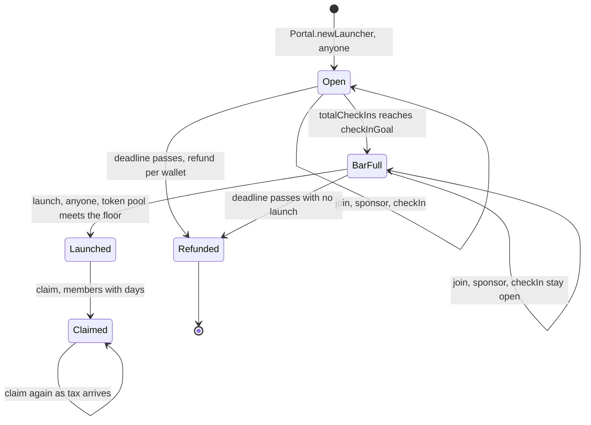
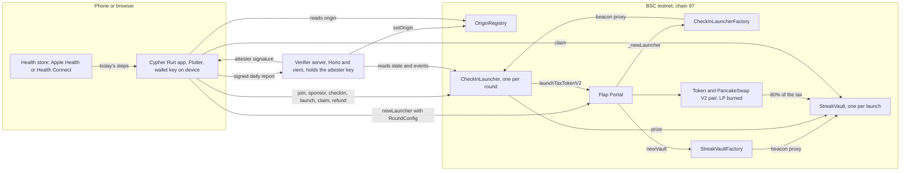
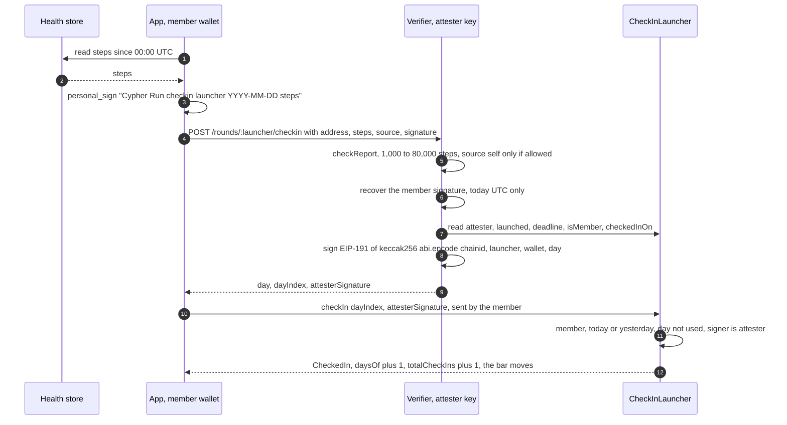
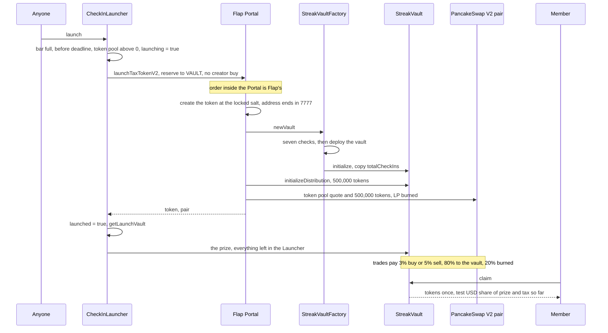

# Cypher Run whitepaper

Check in to launch: a round where showing up, not money, opens a token launch on Flap Pool Launch.

BSC testnet only (chain 97). Every amount here is test USD or test BNB and has no value. Every rule
below is cited to the contract, server function or record that enforces or shows it:
[`contracts/src`](../contracts/src), [`verifier/src`](../verifier/src) and [PROOF.md](../PROOF.md).

| | |
|---|---|
| Web app | https://dokind.github.io/kickoff-bnb-hack/ |
| iPhone (TestFlight, in Apple beta review) | https://testflight.apple.com/join/bp4WaEu5 |
| Android | https://github.com/dokind/kickoff-bnb-hack/releases/download/android-latest/cypher-run.apk |
| Source (MIT) | https://github.com/dokind/kickoff-bnb-hack |
| Proof on testnet | [PROOF.md](../PROOF.md) |

## 1. Abstract

Cypher Run is a commitment round with a deposit on it: members pay the same deposit in test USD,
check in on each day they move, and every check-in fills one shared bar. When the bar reaches its
goal before the deadline, anyone can launch the round's token through Flap Pool Launch; the round is
a Flap Launcher, created by our own Launcher Factory and enabled on the Flap Portal. At launch, part
of the deposits plus any sponsor money seeds the token pool with half the supply, and the rest of the
deposits (the prize), the other half of the supply and 80% of the trading tax go to a vault that
pays members in proportion to their days shown up. If the bar is not full by the deadline, every
deposit goes back in full. A complete round ran on BSC testnet on 25 November 2026: three members,
a member-sent launch, trading tax, and claims of 822.32, 411.16 and 0 test USD for 2, 1 and 0 days.

## 2. The problem

Most people who start a habit stop within weeks. Two tools are known to help, and each fails alone.

- **Stakes without a group.** Deposit apps take your money and return it if you keep a streak. You
  are alone with a timer, the operator holds the money, and the operator decides who kept the
  streak.
- **A group without stakes.** Running clubs and step challenges give you people to show up for,
  but missing a day costs nothing.

Cypher Run puts both in one contract. The deposit is the stake. The bar is the shared goal: nobody
reaches it alone, and every member can see how far the group is. Each day you show up moves the
bar and raises your share.

**Why a token launch is the reward and the finish line.** A launch is an event everyone in the
round can watch arrive, so it works as the finish line. It also turns the round into something that
keeps paying after it ends: the token trades, and 80% of its trading tax flows to the members who
showed up, by their days. On Flap Pool Launch a Launcher decides when a launch may happen. We use
that hook to make the launch condition behaviour (check-ins counted on chain), not money raised.
Money is still needed (Flap's pool floor), but money alone never opens the launch.

## 3. How a round works

One `CheckInLauncher` contract is one round. Its lifecycle, with who may call what:



`BarFull` is not a stored flag: it is `totalCheckIns >= checkInGoal`, read by `canLaunch()`.

| Call | Who | When | Source |
|---|---|---|---|
| `Portal.newLauncher(factory, abi.encode(RoundConfig))` | anyone, paying the 0.005 test BNB salt lock fee | any time | `CheckInLauncherFactory._newLauncher`, `CheckInLauncher.initialize` |
| `join()` | any wallet, once | not launched, `block.timestamp <= deadline` | `CheckInLauncher.join` |
| `sponsor(amount)` | anyone, any number of times | same as join | `CheckInLauncher.sponsor` |
| `checkIn(day, signature)` | a member, once per UTC day | not launched, before the deadline, day is today or yesterday | `CheckInLauncher.checkIn` |
| `launch()` | anyone, once | `totalCheckIns >= checkInGoal`, `block.timestamp <= deadline`, token pool above 0 | `CheckInLauncher.launch` |
| `claim()` | a member with days | any time after the launch | `StreakVault.claim` |
| `refund()` | a member or sponsor | `block.timestamp > deadline` and not launched | `CheckInLauncher.refund` |

The factory refuses a round whose deadline is in the past or more than 90 days away
(`MAX_ROUND_DURATION`), whose deposit or goal is 0, whose `liquidityBps` is above 10,000, or whose
attester is the zero address. A UTC day is `block.timestamp / 86400` (`currentDay()`).

## 4. Money

**Symbols.**

| Symbol | Meaning | On chain |
|---|---|---|
| `d` | deposit, the same for every member | `deposit()` |
| `n` | members | `memberCount()` |
| `b` | liquidity share of the deposits, basis points | `liquidityBps()` (app default 3000) |
| `s` | sponsor money, summed | `totalSponsored()` |
| `C` | all check-ins at launch | `totalCheckIns()`, copied into the vault |
| `c_i` | days shown up by member `i` | `daysOf(member)` |
| `S` | token supply | `TOTAL_SUPPLY` = 1,000,000 tokens |
| `T` | trading tax the vault has received | part of `quoteReceived()` |

**At launch** (`poolQuoteNow()`, `launch()`; all divisions round down):

```
token pool   P = n*d*b/10000 + s                      quote into the PancakeSwap V2 pair
                 with S/2 = 500,000 tokens             (POOL_TOKEN); Flap burns the LP
prize        R = n*d - n*d*b/10000                    sent to the StreakVault in the same tx
reserve        S/2 = 500,000 tokens                   handed to the StreakVault by the Portal
```

`R` is computed as the Launcher's whole remaining balance after the Portal pulls `P`
(`prize = quote.balanceOf(address(this))`), so the pool and the prize always add up to everything
the Launcher held (`test_launch_poolAndPrizeAlwaysAddUpToTheDeposits`), and test USD sent to the
Launcher by mistake becomes prize (`test_launch_strayQuoteSentToTheLauncherBecomesPrize`).

**Claims** (`StreakVault.claimable`, `claim`). Member `i` can claim:

```
tokens       (S/2) * c_i / C                          once, on the first claim
test USD     Q * c_i / C  -  already paid to i        again whenever Q grows
             where Q = R + T = quoteReceived() = balance + totalQuotePaid
```

**Trading tax.** 3% on buys and 5% on sells (`buyTaxRate = 300`, `sellTaxRate = 500`,
`taxDuration = 30 days`, in `_buildParams`). The fee slots (`_feeConfigs`) send 80% of the tax to
the vault (`VAULT_TAX_BPS = 8000`) and 20% to a burn (`DEFLATION`). The vault's part is shared by
the same `c_i / C`. Whether Flap takes a protocol fee before this split was not measured.

**Refund** (`refund()`). If the token has not launched by the deadline, each member takes back `d`
in full and each sponsor what they sponsored. Nothing is kept by anyone. This also holds when the
bar was full but nobody launched (`test_refund_evenWhenTheBarWasFullButNobodyLaunched`).

**Zero days.** A member with `c_i = 0` at launch gets nothing back: no test USD, no tokens, no
tax. `claimable` returns `(0, 0)` and `claim` reverts with `NothingToClaim`. The liquidity part of
their deposit is in the token pool and the rest is in the prize, shared by the members who showed up.
The app's join sheet warns when the bar is one check-in from full or already full.

### Worked example: Bangkok Showup

Real numbers from [PROOF.md](../PROOF.md), Launcher `0xe1c165C295ED8bC0abA2a81c2a524564689BCeAB`.

```
n = 3, d = 500, b = 3000, s = 1,050           C = 3, days: Ana 2, Ben 1, Chai 0

deposits     n*d            = 3 * 500              = 1,500 test USD
liquidity    n*d*b/10000    = 1,500 * 3000 / 10000 =   450
token pool   P = 450 + 1,050                       = 1,500  (meets Flap's 1,500 floor)
prize        R = 1,500 - 450                       = 1,050
tax          T = 37.173735354404480852 + 53.54428161520104926
               + 48.565917682085283203 + 44.196626614586630826
                                                   = 183.480561266277444141
vault total  Q = 1,050 + 183.480561266277444141    = 1,233.480561266277444141

Ana   Q * 2/3 = 822.320374177518296094   (700 at her first claim, 122.320374177518296094 later)
Ben   Q * 1/3 = 411.160187088759148047   (350 of prize + 61.160187088759148047 of tax)
Chai  0                                  (0 days)

tokens: Ana 500,000 * 2/3 = 333,333.333333333333333333
        Ben 500,000 * 1/3 = 166,666.666666666666666666
        1 smallest unit stays in the vault from rounding down
```

Ana's first claim came straight after the launch, when `Q` was 1,050: `1,050 * 2/3 = 700`. Her
second claim paid `Q * 2/3 - 700`. The vault paid out 822.320374177518296094 + 411.160187088759148047
= 1,233.480561266277444141, exactly what it received, and holds 0 test USD (read on 26 November:
`quoteReceived()` and `totalQuotePaid()` both 1,233.480561266277444141). Each paid 500. Ana got 822.32
test USD and a third of the supply, Ben 411.16 and a sixth, Chai nothing. The sponsor's 1,050 went
into the token pool and earned no share.

## 5. Architecture



- **App** ([`app/`](../app)): Flutter for web, iOS and Android. Makes a wallet on the device, reads
  steps from Apple Health or Health Connect (or a typed number on the web), mines the launch salt,
  and sends every transaction from the member's own wallet.
- **Verifier** ([`verifier/src`](../verifier/src)): checks a member's daily report and returns the
  attester signature (`app.ts` `checkInRoute`, `attest.ts` `signCheckIn`); finds every round from the
  factory's `CheckInLauncherCreated` events (`rounds.ts`); relays chain state, streaks and stats;
  sends a new wallet test BNB once for gas (`faucet.ts`); writes its own host to OriginRegistry
  (`origin.ts`). It sends no transaction to a Launcher or a vault.
- **Contracts** ([`contracts/src`](../contracts/src)): our four contracts plus `OriginRegistry`,
  over Flap's base contracts in `contracts/src/flap`, copied unmodified from
  `flap-sh/FlapPoolLaunchVaultExample`.

### A check-in



The digest is `checkInDigest(wallet, day)`:
`toEthSignedMessageHash(keccak256(abi.encode(block.chainid, address(this), wallet, day)))`, and the
server builds the same bytes in `checkInInner` (`verifier/src/attest.ts`). One vector is pinned in
the contract tests and reproduced byte for byte in `verifier/test/attest.test.ts`.

### A launch and a claim



In round 1 the launch took 4,642,852 gas, sent by a member wallet ([PROOF.md](../PROOF.md)).

## 6. Integration with Flap Pool Launch

**Launcher Factory hook.** `CheckInLauncherFactory` extends Flap's `LauncherFactoryBase`. A round
is created with `Portal.newLauncher(factory, data)`; the Portal calls `_newLauncher(creator, data)`.
It decodes `data` as one `RoundConfig` tuple `(name, symbol, meta, salt, deposit, liquidityBps,
checkInGoal, deadline, attester)` and insists on the canonical encoding
(`keccak256(abi.encode(c)) == keccak256(data)`, so trailing bytes are refused). It validates the
fields (section 3), deploys an ERC-1967 beacon proxy at `salt`, and calls `initialize`.
`launcherDataSchema()` describes the nine fields for Flap's UI.

**Launcher hook.** `CheckInLauncher` extends `LauncherBase`. In `initialize` the Launcher itself
pays exactly `SALT_LOCK_FEE` (0.005 test BNB, read from the Portal) and calls
`lockSalt(salt, DIRECT_V2_POOL_TAX)`, because the Portal records the caller as the locker.
`_description()` reports `targetRaise = 0` (the launch opens on check-ins, not on money in) and a
50% `poolTokenRatio`. `launch()` calls `launchTaxTokenV2` with `totalSupply` 1,000,000,
`poolToken` 500,000, the tax settings above, `antiFarmerDuration` 1 day, the creator extension,
and a `Distribution` of the other 500,000 tokens to `VAULT`.

**Vault factory checks.** The Portal calls `StreakVaultFactory.newVault` during the launch. Before it
deploys, it requires (from the contract's own list):

1. the caller is the Portal (`onlyHub`) and Flap's common checks in `_validateLaunch` pass (one
   VAULT slot naming this factory, non-zero bps, supported quote);
2. the launching Launcher was recorded by the Portal for our `launcherFactory`;
3. `vaultData` is exactly `abi.encode(launcher)` and names the calling Launcher;
4. the quote token is the Launcher's ERC-20;
5. the VAULT slot is exactly 8000 bps;
6. the reserve goes to the vault and equals `totalSupply - poolToken`;
7. the Launcher's `launching` flag is set, so check-ins are closed and the vault's copy of
   `totalCheckIns` is final (the vault also refuses `totalCheckIns == 0`).

**Salt mining to the 7777 suffix.** The Portal requires the token address to end in `0x7777`. The
token is a CREATE2 clone deployed by the Portal, so its address is the last 20 bytes of
`keccak256(0xff ++ portal ++ salt ++ initCodeHash)`. The app mines a salt from a random 32-byte
seed, about 65,000 hashes on average (`mineSalt`, `mineSaltAsync` in
`app/lib/services/chain_service.dart`: a background isolate on a phone, chunks of 500 on the web).
`contracts/test/Salt.t.sol` pins the formula against the clone prediction. The round 1 token is
`0x79F03A11234CFF1Bca37860B29ddb6a7947B7777`.

**The tax slot.** Two fee slots that sum to 10,000 bps as the Portal requires: `VAULT` 8000 with
`FeeConfigVault{vaultFactory, vaultData: abi.encode(launcher)}`, and `DEFLATION` 2000. Flap's tax
processor turns the tax into test USD and `dispatch()` (open to anyone) pays the vault. In round 1
an outside account dispatched it four times within a few blocks of the trades.

**LP burn.** `DIRECT_V2_POOL_TAX` seeds a PancakeSwap V2 pair and burns the LP. The token pool is
permanent liquidity: nobody, including us, can pull it.

**Enabled on the Portal.** `launcherFactoryMultiplier(0x2A872200B83dD025977d785cDE05356d23eA4153)`
reads `true, 10000`: enabled at 1x. It was enabled in
[`0x2a7d7106…d9ad45`](https://testnet.bscscan.com/tx/0x2a7d71063496b439a12248f90b133ce5230d7c9581a25b6af84ede2ec3d9ad45)
through Flap's testnet helper `0x77779969a11eff7582f3bCf48135A846A3457777`. At 1x the Portal's
floor is 1,500 test USD of token pool today; below it `launch()` reverts as a whole and nothing
changes, so a sponsor can top up and anyone can call again
(`test_launch_belowThePortalFloorRevertsUntilASponsorTopsUp`).

**Upgrades.** Both factories hold an `UpgradeableBeacon`; `upgradeVaultImplementation` is
`onlyGuardian` (Flap's Guardian), as in Flap's example. There is no owner and no other privileged
function.

## 7. Trust and security

**The attester's exact bound.** The attester is one address fixed per round (`attester()`), the
server's key `0x2F2ab3dA0b824F9cA3EdD2580443Ca0b271EfDD7`. Check-ins are attested, not proven.
`checkIn` takes a signature only:

- over `(chainid, this Launcher, msg.sender, day)`, so it is good for one wallet, one round, one
  chain and one day, and only in a transaction sent by that member;
- for `day` equal to today or yesterday (`InvalidDay`);
- once per member per day (`checkedInOn`, `AlreadyCheckedIn`);
- from a member who paid the deposit (`NotMember`), before the launch and the deadline.

So the key can give a member at most one day for each UTC day from the day before they joined
until the launch, and it can withhold any day. It has no function on the Launcher or the vault: it
cannot launch, cannot block a launch once the bar is full (anyone can call `launch()`), cannot move
or receive funds. If it stops signing, the bar never fills and everyone is refunded. In round 1 the
operator signed one check-in for the day before by hand with this key; PROOF.md says so.

**Replay.** The chain id and Launcher address in the digest stop cross-round and cross-chain
replay; `checkedInOn[member][day]` stops same-day replay. On the server, the member's report is a
personal_sign over `Cypher Run checkin <launcher> <YYYY-MM-DD> <steps>` (`checkInMessage`); a report
for another day is refused with `wrong_day`, and asking again returns the same attester signature
without changing the stored report.

**One check-in per UTC day.** Enforced on chain as above. The server signs for today only.

**Reentrancy.** `join`, `sponsor`, `refund` and `claim` write their state before the token
transfer: `refund` zeroes the sponsor amount and membership before `safeTransfer`, and `claim`
records `claimedTokens` and `claimedQuote` before transferring. During the Portal call in `launch`,
the `launching` flag makes `join`, `sponsor`, `checkIn` and `launch` revert with
`LaunchInProgress`. The quote token is fixed at factory construction. There is no `nonReentrant`
modifier; the order of writes and the `launching` flag are the protection.

**Rounding.** All divisions round down. Because the vault tracks what each member was already paid
and pays `Q * c_i / C - paid`, the sum paid can never exceed `Q`. Dust stays in the vault (one
smallest token unit in round 1; `test_claim_roundingLeavesOnlyDust`).

**Who can launch.** Anyone, once, with a full bar, at or before the deadline. In round 1 a member
sent it, not the operator.

**Refund.** Strictly after the deadline, only if not launched, each wallet gets exactly what it
paid in. Nobody can withdraw from the Launcher or the vault except through `refund` and `claim`.

**Sybil wallets and typed steps.** Nothing ties a wallet to a person. Each extra wallet pays its own
deposit and earns at most one day per UTC day, so splitting into wallets buys share at the same
price as anyone else; it does not create free share. The weaker point is evidence: with
`ALLOW_SELF_REPORTED=true` the server signs a typed number (`checkReport` in `rules.ts`). That
switch is how the web demo works on testnet and it proves nothing. Phones send Apple Health or
Health Connect counts, which the server also cannot verify. Mainnet turns the switch off.

**Key custody on the device.** The app makes the key with a secure random source and keeps it in
the platform keystore (Keychain or Keystore) through `flutter_secure_storage`; in a browser that is
the site's storage (`WalletStore`). The key never leaves the device. The app offers "Back up your
key".

**OriginRegistry.** `0xb9aD45Dc177C801f10670F2aac03B467f1C367d2` holds one string, `origin()`,
settable only by `announcer`, which is the attester address (`setOrigin`). The server writes its
current tunnel host there (`origin.ts`), and the apps read it before their first call. A wrong value
cannot move funds or sign check-ins: rounds accept only the attester's signature. It can send the
apps to a server that cannot sign, or one that lists wrong rounds. Writing a wrong value needs the
attester key. v2: the app checks `Portal.getLauncher(launcher).launcherFactory` before joining.

**Tests that cover this.** Run for this paper: contracts 69 passed and 1 skipped without an RPC
(74 with a BSC testnet RPC, including 5 fork tests against the live Portal); server 171 passed in 10
files.

| Area | Tests | Where |
|---|---|---|
| Check-in rules, signature binding, replay, day window | 14 | `CheckInLauncher.t.sol` |
| Launch: goal, anyone, once, deadline, floor, split | 11 | `CheckInLauncher.t.sol`, `StreakVault.t.sol`, fork suite |
| Refund | 7 | `CheckInLauncher.t.sol`, fork suite |
| Vault: shares, zero days, rounding, only once, Portal only | 11 | `StreakVault.t.sol` |
| Factories: config validation, Portal only, paired factory, Guardian upgrades | 8 | both |
| OriginRegistry | 6 | `OriginRegistry.t.sol` |
| Salt formula | 2 | `Salt.t.sol` |
| Server check-in route and signature vector | 26 | `checkin.test.ts`, `attest.test.ts` |
| Server origin announcer | 21 | `origin.test.ts` |

## 8. Known limits and v2

- **Late joiners.** Days freeze at launch. A member who joins near a full bar can have 0 days when
  someone launches, and get nothing. The app warns and asks for a second press. *v2:* a join cutoff
  and a minimum round length.
- **Liquid reserve.** Reserved tokens are claimable and sellable right after launch, so the first
  seller gets the best price. *v2:* release them over the 30-day tax window through a vault upgrade.
- **Tax share frozen at launch.** Showing up after launch earns no more tax. *v2:* keep counting
  check-ins during the tax window and share the tax by those.
- **Single attester.** One key signs every check-in, announces the host and, without
  `FAUCET_PRIVATE_KEY`, pays the faucet (the event uses a separate faucet wallet,
  `0xaC33dE0fe7C7a2e779A9Ba9C116C1fFe0aCd19f8`). It can also sign a day before the round opened.
  *v2:* BNB Attestation Service attestations, a KMS-held key, the Launcher refuses days before its
  opening day.

**What breaks at 10,000 users.**

| Part | Today | Fix |
|---|---|---|
| Server store | One JSON file, rewritten on each change (`store.ts`) | Postgres |
| Discovery | Factory log scan in chunks; members are wallets the server has seen | An indexer on factory and Launcher events, paged lists |
| RPC | One public endpoint | Paid endpoint with fallback |
| Attester | One key in an environment variable | KMS key, one attester per round set (already a per-round field) |
| Gas | Faucet: 0.03 test BNB per new wallet by default, 200 wallets in all | BSC paymaster |
| Hosting | Cloudflare quick tunnel | Named tunnel or VM; apps already follow OriginRegistry |
| Contracts | Per-member mappings; no call loops over members | No change needed for size |

## 9. Business model and roadmap

**Sponsor-funded rounds.** A club, race or brand funds the token pool and the round sets
`liquidityBps` to 0, so every deposit is prize; the factory accepts 0 to 10,000 and `launch()` only
needs a non-empty token pool. Planned revenue is a flat fee per sponsored round, charged to the
sponsor off-chain. Nothing in the contracts takes a fee and no fee has been charged. *v2:* a
treasury slot in a new factory, taken from the 20% burn share, so members keep their 80%.

**Roadmap on the BNB stack.**

1. Gas through a BSC paymaster, so a new member needs no BNB.
2. Check-ins as BNB Attestation Service attestations.
3. A stablecoin as the quote token.
4. Mainnet only after an audit and Flap's enabling of the factory there.
5. Rounds that feed rounds: a member can claim and `sponsor()` the next round's token pool today.

## 10. Proof on testnet

Full record, with all 47 transactions of round 1: [PROOF.md](../PROOF.md).

| What | Address |
|---|---|
| CheckInLauncherFactory | [`0x2A872200B83dD025977d785cDE05356d23eA4153`](https://testnet.bscscan.com/address/0x2A872200B83dD025977d785cDE05356d23eA4153) |
| StreakVaultFactory | [`0x0652AAD1d659344f6EdB9572723479aaece144Be`](https://testnet.bscscan.com/address/0x0652AAD1d659344f6EdB9572723479aaece144Be) |
| Flap Portal | [`0x000042108465206185A077Edc3F3fd2b49060000`](https://testnet.bscscan.com/address/0x000042108465206185A077Edc3F3fd2b49060000) |
| Test USD | [`0x190C989D5665a0e404B444b53CAE9AbCfb600157`](https://testnet.bscscan.com/address/0x190C989D5665a0e404B444b53CAE9AbCfb600157) |
| Attester | [`0x2F2ab3dA0b824F9cA3EdD2580443Ca0b271EfDD7`](https://testnet.bscscan.com/address/0x2F2ab3dA0b824F9cA3EdD2580443Ca0b271EfDD7) |
| Faucet wallet | [`0xaC33dE0fe7C7a2e779A9Ba9C116C1fFe0aCd19f8`](https://testnet.bscscan.com/address/0xaC33dE0fe7C7a2e779A9Ba9C116C1fFe0aCd19f8) |
| OriginRegistry | [`0xb9aD45Dc177C801f10670F2aac03B467f1C367d2`](https://testnet.bscscan.com/address/0xb9aD45Dc177C801f10670F2aac03B467f1C367d2) |
| "Bangkok Showup" Launcher | [`0xe1c165C295ED8bC0abA2a81c2a524564689BCeAB`](https://testnet.bscscan.com/address/0xe1c165C295ED8bC0abA2a81c2a524564689BCeAB) |
| its token | [`0x79F03A11234CFF1Bca37860B29ddb6a7947B7777`](https://testnet.bscscan.com/address/0x79F03A11234CFF1Bca37860B29ddb6a7947B7777) |
| its vault | [`0x93873812C48C9f5fCD3594fD651Ce9Ce96c75728`](https://testnet.bscscan.com/address/0x93873812C48C9f5fCD3594fD651Ce9Ce96c75728) |
| its launch, sent by a member | [`0xe9d53da5…adb896`](https://testnet.bscscan.com/tx/0xe9d53da5e8ce1bc49e859a42a1f55879a6f056fb3a09b5dca8a9aa55e3adb896) |
| "Bangkok Demo Run" Launcher, the judges' round | [`0xcF7957Dc48E5c16732331d27E2C2a1b2A9FA5876`](https://testnet.bscscan.com/address/0xcF7957Dc48E5c16732331d27E2C2a1b2A9FA5876) |

**Bangkok Demo Run**, read with `cast` at block 144930834 (26 November 2026, 06:21 UTC): deposit
100 test USD, `liquidityBps` 3000, goal 12, bar 3 of 12, 4 members, sponsor money 1,410 test USD,
`poolQuoteNow()` 1,530 test USD (already above the 1,500 floor, so only check-ins decide the
launch), `prizeQuoteNow()` 280 test USD, not launched, deadline 30 November 2026 00:34:28 UTC.
Join it in the web app, check in, and watch the bar.

Not yet shown on testnet: a `refund()` (it needs a round whose deadline has passed) and a check-in
from a phone's health data. The round 1 check-ins were self-reported test entries.

## 11. Glossary

| Term | Meaning |
|---|---|
| Round | One `CheckInLauncher`: one deposit size, one goal, one deadline, one token |
| Deposit | The test USD every member pays once to join (`deposit()`) |
| Check-in | One member's record for one UTC day, carrying the attester's signature |
| Bar | All check-ins of all members (`totalCheckIns()`); full at `checkInGoal()` |
| Days shown up | A member's check-ins (`daysOf()`); their share is days over all check-ins |
| Token pool | Test USD and half the supply that seed the PancakeSwap V2 pair at launch; LP burned |
| Prize | The deposits minus their liquidity part, sent to the vault at launch |
| Sponsor money | Test USD added with `sponsor()`; token pool only, no share, refunded if no launch |
| Refund | Getting back exactly what you paid in, after a deadline with no launch |
| Attester | The server key whose signature every check-in needs |
| StreakVault | The per-launch vault that pays tokens, prize and tax by days shown up |
| Pool floor | The least token pool the Flap Portal accepts: 1,500 test USD today at 1x |
| UTC day | `block.timestamp / 86400`; a new day starts at 07:00 in Bangkok |
| OriginRegistry | On-chain record of the server's current host, written only by the attester |
| Test USD | Flap's free-mint test token on BSC testnet; no value |
